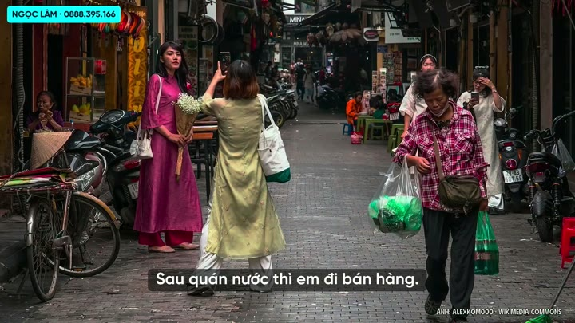
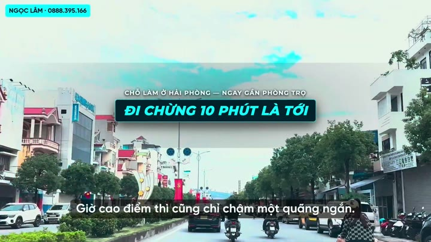
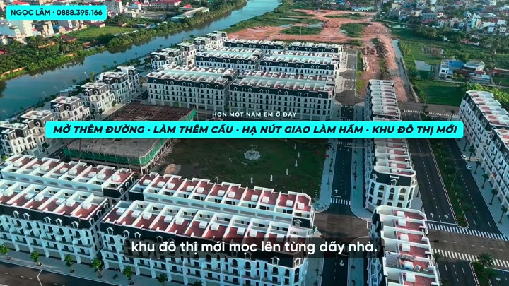

# Ghi chú video mẫu — "Bỏ Hà Nội về Hải Phòng hơn 1 năm"

## 1. Thông tin
- Tiêu đề gốc: Bỏ Hà Nội về Hải Phòng hơn 1 năm: tôi được nhiều hơn mình tưởng
- Nền tảng: YouTube (kênh Ngọc Lâm BĐS). Bản Facebook của video này: `fb-2217392492206954`.
- Ngày đăng: 14/10/2026
- Thời lượng: 10:09 (609 giây), ngang 16:9
- Lượt xem: 8.421 (theo info.json lúc tải)
- Link: https://www.youtube.com/watch?v=D4InJTv33kg

## 2. Một câu
Một người trẻ kể thật chuyện rời Hà Nội về Hải Phòng sống hơn một năm: 7 năm 4 nghề vẫn tay trắng, mấy tháng đầu không có thu nhập, rồi một ngày ở thành phố mới khác ngày cũ ở đâu, được gì và phải chịu gì.

## 3. Format
**Kể chuyện chuyển về sống** (người kể là chính tác giả, có "được" và có "phải chịu").

## 4. Mở đầu (hook)
> "Một người rời Hà Nội về Hải Phòng sống thì cuộc sống hơn Hà Nội chỗ nào? Bởi vì đó là chuyện của em hơn một năm vừa qua. 7 năm đi làm ở Hà Nội, 4 kế nghề và sau 7 năm đó thì em vẫn chưa để ra được gì."

(Whisper chép "4 kế nghề" = "4 nghề"; mô tả video ghi "4 nghề".)

Công thức hook: **một câu hỏi so sánh + "đây là chuyện của chính em" + một con số đau (7 năm, 4 nghề, chưa để ra được gì) + một điều "không hề tính tới"** để người xem muốn nghe tiếp. Sau đó mới tự giới thiệu tên và nói trước 4 câu hỏi video sẽ trả lời.

## 5. Cấu trúc
Video có chapter YouTube, giờ lấy theo chapter:
- 00:00 Mở đầu: hook, tự giới thiệu, nêu 4 câu hỏi sẽ trả lời
- 00:49 7 năm ở Hà Nội, 4 nghề mà vẫn tay trắng: du lịch, quán nước, bán hàng, chạy xe công nghệ; phòng 20 m², 3 triệu/tháng
- 01:56 Bố mẹ bảo về quê Lai Châu, vì sao em không về: nghề muốn theo không có chỗ ở quê
- 02:59 Mấy tháng đầu ở Hải Phòng, thu nhập bằng không: thuê phòng An Đồng 1,5 triệu, chưa biết đường
- 04:08 Một ngày ở đây dài hơn một ngày ở Hà Nội: đi làm 10 phút thay vì 30 – 45 phút
- 05:23 Cuối tuần ra biển Đồ Sơn và Cát Bà
- 06:36 Chỗ chơi ít hơn Hà Nội nhưng em đi được nhiều hơn (ăn sáng, chợ Pháp hơn 100 năm)
- 07:49 Thành phố đang xây, mỗi năm một khác
- 08:46 Hơn một năm được gì và phải chịu gì: xe đầu kéo, làm lại từ đầu quan hệ, chưa mua nhà
- Cuối (khoảng 09:41): "Hải Phòng cũng là một lựa chọn" + xin chỉ chỗ ăn ngon + like/đăng ký

Mẫu nhịp: mỗi chương dài khoảng 70 giây, mỗi chương một ý ("một ngày", "cuối tuần", "thành phố đang xây"), và luôn có một chương nói thẳng điều chưa hay.

## 6. Hình ảnh
Contact sheet 12 khung đã xem. Phong cách:
- Không có người nói trước ống kính. Chỉ có giọng kể (voiceover) trên cảnh minh hoạ.
- Cảnh quay: flycam khu đô thị, cầu, nút giao đang thi công; cảnh đường phố ban ngày và ban đêm; ảnh tư liệu Hà Nội (phố cổ, người bán rong) và núi rừng Tây Bắc (có dòng ghi nguồn ảnh Wikimedia Commons ở góc); ảnh món ăn (bánh đa cua); flycam Cát Bà, nhà bè.
- Có thanh nhãn nhỏ ở góc trên trái "NGỌC LÂM · 0888.395.166" suốt video. Khung đầu có thẻ tên "NGỌC LÂM".
- Phụ đề to, màu trắng, đặt dưới giữa khung.
- Thẻ chữ nhấn ý ở giữa (nền xanh ngọc, chữ trắng đậm), ví dụ "ĐI MỘT ĐÊM RỒI HÔM SAU VỀ", "THÊM MẤY TIẾNG MỖI NGÀY · ĐI LÀM 10 PHÚT · BIỂN NGAY GẦN", "HẢI PHÒNG CŨNG LÀ MỘT LỰA CHỌN".
- Ba khung đã lưu: `anh-01.jpg` (đoạn đầu), `anh-02.jpg` (giữa), `anh-03.jpg` (cuối).

  

## 7. Cách đặt tiêu đề & mô tả
**Tiêu đề:** "Bỏ [nơi cũ] về [nơi mới] hơn 1 năm: tôi được nhiều hơn mình tưởng". Công thức: *hành động đáng kể + mốc thời gian cụ thể + lời hứa kết quả mang cảm xúc*. Người xem tự hỏi "được gì?".

**Mô tả** có cấu trúc:
1. Câu tóm tắt có từ khoá tìm kiếm ("cuộc sống ở Hải Phòng của em thay đổi thế nào").
2. Đoạn nêu số cụ thể: phòng 1,5 triệu so với 3 triệu; 10 phút so với 30 – 45 phút.
3. Danh sách chapter có giờ (9 mục).
4. Đoạn **"Nói cho công bằng"**: nói thẳng Hải Phòng không rẻ, rẻ hơn chỉ có tiền nhà và đường đi, kèm câu nguồn ("chỉ số giá sinh hoạt theo không gian năm 2025 của Cục Thống kê") và câu "những phần còn lại là chuyện riêng của em, mỗi người một hoàn cảnh".
5. Câu mời bình luận.
6. Câu liên hệ bất động sản kèm số điện thoại (đặt gần cuối, nhẹ).
7. Link video khác trong kênh + link bài chi tiết trên vungoclam.com (`/cuoc-song-o-hai-phong/`).
8. Hashtag: #haiphong #cuocsonghaiphong #ngoclambds

## 8. Lời kêu gọi (CTA)
Trong video, đặt ở cuối, rất nhẹ, không bán hàng:
> "Quý cô chú chị nào sống đây lâu rồi thì chỉ giúp em mấy hàng ăn ngon. Hay chỗ nào buổi tối vui mà em chưa biết... Hãy để lại ý kiến với bình luận nhé. Và trước khi kết thúc video anh chị hãy cho em xin một like và một đăng ký kênh"

Mô tả mới có lời mời liên hệ bất động sản và số điện thoại. Điểm hay: CTA bình luận hỏi một việc nhỏ, dễ trả lời.

## 9. Số liệu & nguồn
- 7 năm, 4 nghề ở Hà Nội. Phòng trọ khoảng 20 m², 2 người, tiền trọ + điện 3 triệu/tháng; xe máy 500.000 đồng (tự kể, không có nguồn ngoài, là chuyện cá nhân).
- Phòng ở An Đồng 1,5 triệu/tháng; đi làm 10 phút thay vì 30 – 45 phút (tự kể).
- Hà Nội đắt nhất trong 34 tỉnh thành: **nêu nguồn** "chỉ số giá sinh hoạt năm 2025 của Cục Thống kê" (cả trong lời và trong mô tả).
- Đường Phạm Văn Đồng hơn 4.000 cây phượng; chợ họp từ thời Pháp, ngoài 100 năm; Hải Phòng cách Hà Nội khoảng 100 km, cao tốc khoảng 2 giờ (không nêu nguồn).
- Hai con số đầu là trải nghiệm cá nhân nên không cần nguồn. Ba con số sau là số công khai, video không nêu nguồn.

## 10. Làm cho Hạ Long Xanh / Quảng Ninh
**Gợi ý tiêu đề (chỉ dùng nếu câu chuyện là thật):**
1. "[Tên khách thật] rời [nơi cũ] về Hạ Long: một năm sau được gì, phải chịu gì" (khách tự kể, có đồng ý lên hình)
2. "Một ngày ở gần Tuần Châu có dài hơn một ngày ở [thành phố cũ]? Linh đi đo thật cho anh chị xem"
3. "Sống gần Hạ Long Xanh: đi làm [cần tra: đo thực tế] phút, ra biển [cần tra: đo thực tế] phút, và 3 điều phải chịu"

**Chị Linh phải tự quay / tự làm thật:**
- Đi quãng đường thật từ khu Tuần Châu – Hà An vào trung tâm Hạ Long, vào giờ cao điểm sáng và chiều, bấm giờ, quay màn hình bản đồ.
- Một ngày sinh hoạt thật của một người đang sống hoặc làm gần đó (chợ, trường, bệnh viện, quán ăn sáng, buổi tối).
- Mặt "phải chịu": giao thông, thời tiết mùa đông, giá ăn uống, chỗ chơi tối, đường đang thi công.

**Phải kiểm trước khi đăng:**
- Giá thuê nhà, giá ăn uống ở Hạ Long [cần tra: nguồn số liệu giá hoặc tự khảo sát có ngày tháng].
- Thời gian di chuyển (tự đo). Khoảng cách tới biển và tới ga/ bến [cần tra].
- Nếu nhắc chỉ số giá sinh hoạt của Quảng Ninh: [cần tra: Cục Thống kê, năm, thứ hạng].

**Lưu ý trung thực:** chị Linh không được nhận câu chuyện "7 năm 4 nghề, rời Hà Nội" là của mình nếu không đúng. Dùng ngôi thứ ba ("khách của Linh") hoặc kể chuyện thật của riêng chị. Không bịa người thật, không dựng cảnh "khách" bằng diễn viên mà không ghi rõ.
