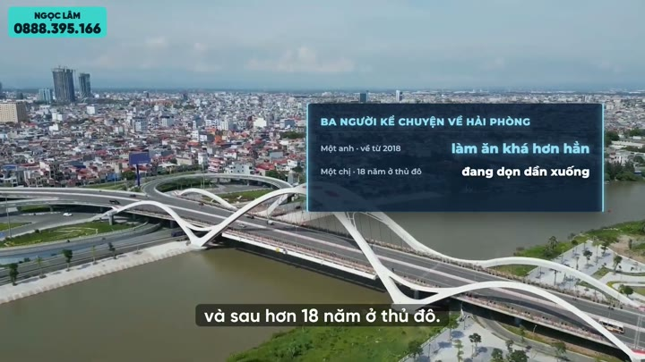
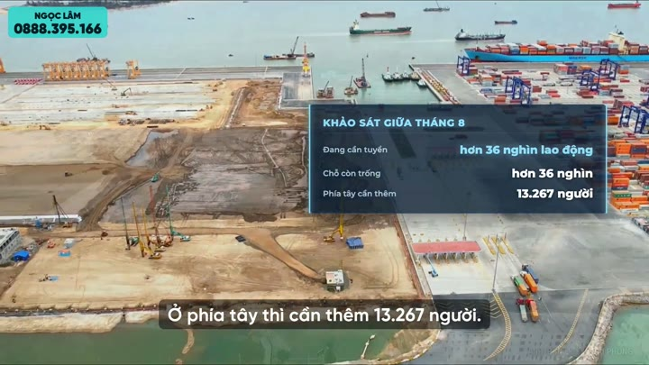

# Ghi chú video mẫu — "Vì sao ngày càng nhiều người tỉnh khác chọn Hải Phòng?"

## 1. Thông tin
- Tiêu đề gốc: Vì sao ngày càng nhiều người tỉnh khác chọn Hải Phòng?
- Nền tảng: YouTube (kênh Ngọc Lâm BĐS)
- Ngày đăng: 11/11/2026
- Thời lượng: 11:19 (679 giây), ngang 16:9
- Lượt xem: 5.315 (theo info.json lúc tải)
- Link: https://www.youtube.com/watch?v=fP2GBXwaom4

## 2. Một câu
Người tỉnh khác về làm trong khu công nghiệp Hải Phòng: bao nhiêu người, làm nghề gì, lương bao nhiêu, ở đâu, còn bao nhiêu chỗ trống, và mặt chưa hay của việc đông thêm người.

## 3. Format
**Một con số lớn của thành phố, kể bằng chuyện người đi làm** (việc làm và chỗ ở). Mở bằng chuyện cá nhân + bình luận của khán giả, rồi đi vào số liệu.

## 4. Mở đầu (hook)
> "Vì sao ngày càng nhiều người tỉnh khác chọn về hải phòng. Và hôm trước em có đăng một video kể chuyện em rời Hà Nội về đây. Và sau video đó, rất nhiều anh chị vào kể là họ cũng đã chuyển về từ rất lâu."

Công thức hook: **tiêu đề làm câu hỏi + "sau video trước, khán giả kể thêm" (nối tập) + một tỷ lệ dễ hình dung (cứ 10 người đi làm thì gần 4 người quê tỉnh khác) + một con số gây bất ngờ (công ty bỏ 14 – 30 triệu chỉ để tuyển một người)**.

## 5. Cấu trúc (chapter YouTube, mm:ss)
- 00:00 Vì sao người tỉnh khác chọn về Hải Phòng (hook + giới thiệu)
- 01:06 Em đi sau rất nhiều người (bình luận khán giả; cảnh xe đưa đón công nhân buổi sáng)
- 02:10 375.347 người đang làm trong khu công nghiệp (so sánh: bằng cả một thị xã)
- 02:32 Ba thứ kéo người ngoại tỉnh về đây: thiếu người thật (37,4% từ tỉnh khác), chỗ ở, việc còn mở thêm
- 03:30 Nhà ở xã hội ngay cạnh khu công nghiệp
- 03:58 Về Hải Phòng làm công nhân lương bao nhiêu (12,69 triệu bình quân, có nói "bình quân khác với người mới vào")
- 04:50 Hơn 36 nghìn chỗ làm còn trống
- 05:06 Thiếu người nhất: Tràng Duệ, VSIP, An Dương
- 05:31 Khu công nghiệp ở đâu thì chỗ ở theo đó (tác giả kể mình ở An Đồng)
- 06:09 Ngành cần người: điện tử, cơ khí, dệt may
- 07:02 Về Hải Phòng làm được những việc gì (nhà máy, công trường, cảng, dịch vụ quanh nhà máy)
- 07:51 Việc ở cảng và dịch vụ quanh nhà máy
- 08:46 "Đông đủ rồi, đừng về nữa" thì sao (mặt chưa hay: đường đông, trường đông, trọ nhích lên)
- 09:21 Tới năm 2030 cần khoảng 400 nghìn lao động
- 10:15 Ba con số trả lời câu "về đây lấy gì mà sống" (tóm tắt) + câu hỏi bình luận

## 6. Hình ảnh
Contact sheet 12 khung đã xem. Phong cách:
- Không người nói trước ống kính. Giọng kể trên cảnh minh hoạ.
- Chủ yếu flycam khu công nghiệp, đường lớn xe container, cảng, khu nhà ở; cảnh trong nhà máy (công nhân lắp ráp); xe taxi trên phố; đám đông xếp hàng ngoài cổng nhà máy.
- **Thẻ số liệu** nền xanh navy trong mờ, bên phải khung, tiêu đề nhỏ + giá trị nổi bật (ví dụ "375.347 người", "12,69 triệu/tháng", "Tràng Duệ đứng đầu · VSIP 4.656").
- Thanh nhãn góc trên trái "NGỌC LÂM 0888.395.166" (to hơn trong video YouTube khác).
- Phụ đề trắng dưới giữa. Thẻ tiêu đề phần ("PHẦN 6 · HẢI PHÒNG CÓ GÌ MÀ NGƯỜI TA XUỐNG ĐÂY LÀM"). Thẻ câu hỏi chốt ở cuối ("Chuyển về thành phố mới: tìm việc trước rồi chuyển, hay chuyển rồi tìm việc?").
- Ba khung đã lưu: `anh-01.jpg`, `anh-02.jpg`, `anh-03.jpg`.

  

## 7. Cách đặt tiêu đề & mô tả
**Tiêu đề:** "Vì sao ngày càng nhiều người [nhóm người] chọn [thành phố]?" Công thức: *câu hỏi "vì sao" + xu hướng ("ngày càng nhiều") + nhóm người cụ thể*. Không có số trong tiêu đề, số nằm ở dòng đầu mô tả.

**Mô tả:**
1. Dòng đầu lặp lại tiêu đề rồi ngay một câu số: "Tính tới tháng 9/2026 … 375.347 người … 135.678 người quê ở tỉnh khác — gần 4 trên 10 … hơn 36.000 chỗ làm".
2. Đoạn nói video làm gì, và nói thẳng mặt chưa hay ("đường đông hơn, trường học đông hơn, tiền thuê trọ nhích lên").
3. Mục **NỘI DUNG CHÍNH** có 15 chapter (nhiều, mỗi mục mang một con số hoặc một ý rõ).
4. Tự giới thiệu + CTA bình luận.
5. Link video trước + link bài số liệu và nguồn dẫn đầy đủ trên vungoclam.com (`/viec-lam-khu-cong-nghiep-hai-phong/`).
6. Hashtag: #HaiPhong #ViecLamHaiPhong #KhuCongNghiepHaiPhong
Mô tả không có dòng "nguồn" riêng; nguồn đẩy sang bài trên vungoclam.com.

## 8. Lời kêu gọi (CTA)
> "Còn theo quý cô chú anh chị, nếu chuyển về một thành phố mới, thì anh chị tìm việc trước rồi mới chuyển, hay cứ chuyển rồi tìm việc sau... quý cô chú anh chị nào đang đi làm đây thì kể cho em nghe anh chị đang làm gì. Hãy để lại ý kiến và bình luận cho em nhé. Và trước khi kết thúc video, anh chị hãy cho em xin một like và một đăng ký kênh"

Trong mô tả: link video trước (xem tiếp) + link bài số liệu trên vungoclam.com. Không có CTA bán nhà.

## 9. Số liệu & nguồn
(Whisper chép "375.347.000 người" và "11.742.000", sai; mô tả ghi đúng 375.347 và 135.678.)
- 375.347 người đang làm trong khu công nghiệp và khu kinh tế, tính tới tháng 9/2026; trong đó 363.605 người Việt và 11.742 người nước ngoài.
- 135.678 người quê ở tỉnh khác, khoảng 37,4% lao động Việt (362.528 người).
- Có công ty hơn 11.000 lao động trong nước, khoảng 56% là người ngoại tỉnh.
- Doanh nghiệp bỏ 14 – 30 triệu đồng để tuyển một lao động phổ thông.
- Năm nay xây hơn 7.135 căn nhà xã hội; hết tháng 8 xong 2.050 căn.
- Thu nhập bình quân 12,69 triệu/tháng trong khu công nghiệp; cả thành phố trên 10 triệu.
- Hơn 36.000 chỗ trống (khảo sát giữa tháng 8): phía tây cần 13.267; Tràng Duệ nhiều nhất; VSIP 4.656; An Dương 3.293.
- 31 công trình lớn làm cùng lúc, hơn 30.000 tỷ đồng tới tháng 9.
- Thành phố hơn 4,6 triệu người, hơn 3.000 km²; năm nay khu công nghiệp cần hơn 120.000 người; tới 2030 khoảng 400.000 người.
- **Nguồn:** trong lời nói chỉ nói chung ("em thấy một cuộc khảo sát", "thành phố đang nói là còn thiếu lao động"). Không đọc tên cơ quan. Tên nguồn nằm ở bài vungoclam.com (video chỉ dẫn link, chưa kiểm bài).

## 10. Làm cho Hạ Long Xanh / Quảng Ninh
**Gợi ý tiêu đề:**
1. "Vì sao ngày càng nhiều người chọn Quảng Ninh để làm việc và sống?"
2. "Quảng Ninh đang cần bao nhiêu lao động? Lương bao nhiêu, ở đâu? [cần tra: số liệu mới nhất]"
3. "Khu kinh tế Quảng Ninh: 3 thứ kéo người về, và 1 điều anh chị cần biết trước khi chuyển"

**Chị Linh phải tìm / quay thật:**
- Số lao động trong các khu công nghiệp, khu kinh tế Quảng Ninh, số người ngoại tỉnh, số chỗ đang tuyển, lương bình quân [cần tra: Ban Quản lý Khu kinh tế Quảng Ninh, Sở Nội vụ/Sở Lao động, Cục Thống kê; ghi rõ ngày số liệu].
- Nhà ở xã hội / nhà ở công nhân gần khu công nghiệp ở Quảng Ninh [cần tra: số căn, vị trí].
- Cảnh thật: xe đưa đón công nhân, cổng khu công nghiệp, quán cơm trưa, phòng trọ. Phỏng vấn một vài người ngoại tỉnh đang làm (có đồng ý).
- Một chương nói thẳng mặt chưa hay (giá thuê nhà nhích lên, đường đông) kèm số thật.

**Phải kiểm:** mọi số "đang làm", "đang thiếu", "lương" cần có tên cơ quan và ngày. Không lấy số của Hải Phòng thay cho Quảng Ninh. Trong nhóm khách của dự án cao cấp, góc nhìn hợp lý là "dòng người về làm việc kéo theo nhu cầu nhà ở và dịch vụ", không nên dùng số lương công nhân để hứa lợi nhuận.

**Lưu ý trung thực:** chị Linh không có câu chuyện "em cũng từng khăn gói về đây". Chỉ kể chuyện của người thật chị đã phỏng vấn, hoặc mở đầu bằng bình luận thật của khán giả kênh chị.
