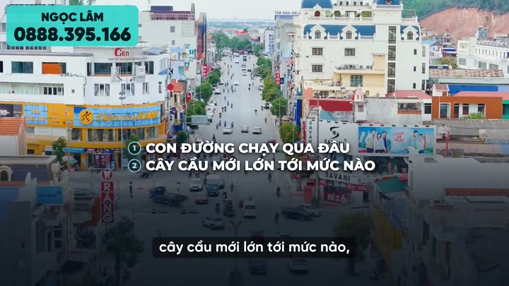
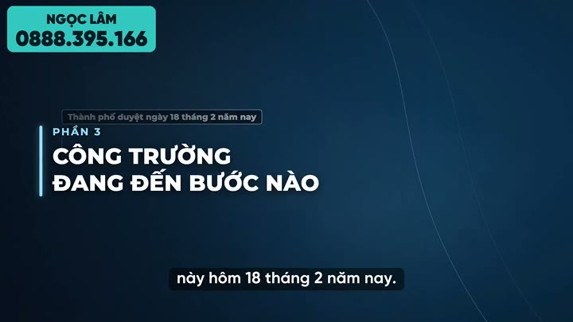
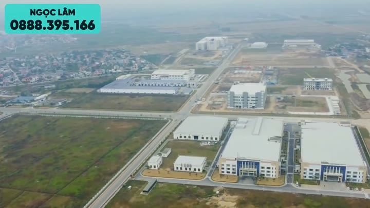

# Ghi chú video mẫu — "Đường vành đai 3 Hải Phòng qua Thuỷ Nguyên"

## 1. Thông tin
- Tiêu đề gốc: Đường vành đai 3 Hải Phòng qua Thuỷ Nguyên
- Nền tảng: Facebook (video trang Ngọc Lâm BĐS), ngang 16:9
- Ngày đăng: 01/11/2026
- Thời lượng: 6:38 (398 giây)
- Lượt xem: 47.544
- Link: https://www.facebook.com/watch/?v=1120384927015378

## 2. Một câu
Đoạn vành đai 3 phía Thủy Nguyên (gần 19 km, hơn 9.900 tỷ) đi qua những phường nào, cầu dây văng mới lớn cỡ nào, công trường đang ở bước nào và ba lợi thế cho khu vực.

## 3. Format
**Hạ tầng một tuyến đường** (tuyến đi đâu, cầu lớn cỡ nào, tiền ở đâu, bao giờ làm, mang lại gì).

## 4. Mở đầu (hook)
> "Đường vành đai ba Hải Phòng sẽ qua những phường nào của Thủy Nguyên, bao giờ thì công trường mở. Hai bờ sông Cấm hiện nối nhau bằng cầu Kiền, cầu Bính, cầu Hoàng Văn Thụ và cầu Hoàng Gia, và cầu Nguyễn Trãi thì đang xây dở. Thành phố vừa duyệt thêm một cây cầu nữa..."

(Whisper chép sai một số tên: "vành đẽ ba" = vành đai 3, "Bĩnh" = Bính; giữ nguyên chữ đúng theo mô tả.)

Công thức hook: **câu hỏi 2 vế (qua đâu, bao giờ) + 3 – 4 sự thật kể nhanh (các cầu cũ, cầu mới 2.100 m, số tiền 9.900 tỷ, 6.600 tỷ đi vay) + 3 câu hỏi video sẽ trả lời**. Hook dài khoảng 55 giây, nhồi số trước rồi mới chào.

## 5. Cấu trúc (theo SRT)
- 00:00 Hook: tuyến, cầu, số tiền
- 00:40 (khoảng) Chào, nói video trả lời gì, "ba lợi thế" của Thủy Nguyên
- 00:56 Phần 1. Từ Bùi Viện tới quốc lộ 10: tuyến dài 18,65 km qua 6 phường, hành lang 68 m
- 02:12 Phần 2. Cầu dây văng mới qua sông Cấm (cầu Ngô Quyền, 2.106 m) và cầu thứ hai qua sông Ruột Lợn (428,6 m)
- 02:55 Phần 3. Công trường đang đến bước nào: duyệt 18/2, vay Ngân hàng Thế giới 6.626 tỷ, đo đất và đếm nhà, tái định cư, mốc khởi công tháng 11 năm sau
- 04:09 Phần 4. Lợi thế thứ nhất: thêm một lối qua sông Cấm
- 04:34 Phần 5. Lợi thế thứ hai: xe hàng có đường riêng ra cảng
- 05:19 Phần 6. Lợi thế thứ ba: gặp đường ra sân bay Gia Bình
- 05:33 Một đoạn nữa nằm trong danh mục 5 năm tới; "Và có thể thấy…" tóm tắt
- 06:20 Câu hỏi bình luận + like/đăng ký + cảm ơn

## 6. Hình ảnh
Contact sheet 12 khung đã xem. Phong cách **đồ hoạ trên nền bản đồ** (không người nói trước ống kính):
- Bản đồ vệ tinh có đường tuyến vẽ màu vàng và nhãn địa danh (cầu, phường, khu công nghiệp VSIP).
- Mô phỏng 2D cây cầu dây văng với số đo ghi trên hình (nhịp chính 230 m, rộng 31,8 m).
- Thẻ số liệu nền xanh navy: "HƠN 9.908 TỶ ĐỒNG", "ĐO ĐẤT, ĐẾM NHÀ DỌC TUYẾN" (thẻ ghi số hộ ở Nam Triệu và Bạch Đằng).
- Xen cảnh flycam sông Cấm, cầu, khu công nghiệp, xe hàng.
- Thanh nhãn lớn góc trên trái "NGỌC LÂM 0888.395.166" (nền xanh ngọc), phụ đề trắng dưới giữa, thẻ tiêu đề phần trên đầu khung.
- Ba khung đã lưu: `anh-01.jpg`, `anh-02.jpg`, `anh-03.jpg`.

  

## 7. Cách đặt tiêu đề & mô tả
**Tiêu đề:** "[Tuyến đường] [thành phố] qua [khu vực]". Công thức: *tên công trình + nơi nó qua*. Ngắn, đúng từ khoá tìm kiếm. Không có số, không có cảm xúc.

**Mô tả Facebook (ngắn):**
1. Dòng đầu là **câu hỏi video trả lời** ("qua những phường nào, bao giờ mở công trường").
2. Một đoạn tóm sự thật có số (các cầu hiện có, cầu dây văng hơn 2.100 m, tên các phường, hơn 9.900 tỷ).
3. Dòng hashtag: #haiphong #vanhdai3 #thuynguyen … #ngoclambds.
Không có chapter, không có link, không có số điện thoại, không có dòng "nói cho công bằng".

## 8. Lời kêu gọi (CTA)
> "Còn theo anh chị, thành phố nên làm cây cầu vượt sông Cấm trước hay đoạn đường qua Thủy Nguyên trước. Hãy để lại ý kiến của phần bình luận nhé! Và trước khi kết thúc video, anh chị hãy cho em xin 1 like và 1 đăng ký kênh..."

Câu hỏi cuối là câu **chọn một trong hai**, dễ trả lời.

## 9. Số liệu & nguồn
- Tuyến dài 18,65 km qua 6 phường; hành lang 68 m, mặt đường 27 m (giai đoạn này).
- Cầu Ngô Quyền 2.106 m, rộng 31,8 m, nhịp chính 230 m, tĩnh không tối thiểu 41 m; cầu qua sông Ruột Lợn 428,6 m; cầu vượt cao tốc gần 195 m.
- Tổng vốn hơn 9.900 tỷ (9.908); Ngân hàng Thế giới cho vay 6.626 tỷ, khoản vay duyệt 4/9; thành phố gần 3.300 tỷ; thành phố duyệt dự án 18/2.
- Nam Triệu: Whisper chép "70,988 hộ", chưa rõ con số đúng (cần xem lại thẻ trên hình khi dùng); Bạch Đằng 419 hộ nhận thông báo; hơn 2.000 hộ có đất trong phạm vi, 181 nhà phải chuyển; khu tái định cư 13,66 ha 733 lô.
- Mốc: bàn giao đất ruộng trong năm nay, đất ở giữa năm sau, mở công trường tháng 11 năm sau (Whisper chép "2017" là nhầm), xong đường vào cầu khoảng 2 năm.
- Lợi thế: ngắn lại khoảng 20 km, nhanh hơn khoảng nửa tiếng; hơn 311.000 người được lợi.
- Nguồn nêu trong lời: "Ngân hàng Thế giới", "theo hồ sơ của thành phố", "theo mốc thành phố đặt ra", "theo bản đồ quy hoạch". Không đọc số văn bản/quyết định cụ thể.

## 10. Làm cho Hạ Long Xanh / Quảng Ninh
**Gợi ý tiêu đề:**
1. "Tàu cao tốc Cổ Loa – Hạ Long đi qua những phường nào của Quảng Ninh, bao giờ xong?"
2. "Đường vào Tuần Châu – Hà An: tuyến nào, cầu nào, bao giờ xong? [cần tra: tuyến cụ thể]"
3. "Từ ga tàu cao tốc về Hạ Long Xanh: đi bao lâu, qua đâu?"

**Dùng được sự thật có nguồn:** tàu cao tốc Cổ Loa – Hạ Long khởi công 12/4/2026, dài khoảng 120 km, dự kiến xong cuối 2028; Hạ Long Xanh / Global Gate Hạ Long ở phường Tuần Châu và Hà An, khởi công 19/12/2025.

**Chị Linh phải làm thật:**
- Tự vẽ bản đồ tuyến (Google Maps hoặc QGIS/ảnh vệ tinh): tuyến đi qua phường/xã nào, ga ở đâu, cách Hạ Long Xanh bao xa [cần tra: vị trí ga Hạ Long, danh sách ga].
- Quay flycam hoặc xin ảnh công trường thật; không dùng ảnh minh hoạ nếu không ghi "ảnh minh hoạ".
- Mỗi lợi thế một thẻ, nói ai được lợi (người đi làm, xe hàng, khách du lịch).

**Phải kiểm:** tổng vốn, ai bỏ vốn, số ga, tốc độ thiết kế, mốc từng đoạn [cần tra: quyết định phê duyệt, thông báo của Bộ/UBND tỉnh]. Mọi chỗ "bao giờ xong" phải ghi "theo kế hoạch" và nêu ngày nguồn. Không hứa "nhà sẽ tăng giá" từ một con đường.

**Lưu ý trung thực:** chị Linh là người môi giới của dự án, nên nói rõ vai trò của mình khi nhắc dự án; không giả làm người dân địa phương trung lập.
