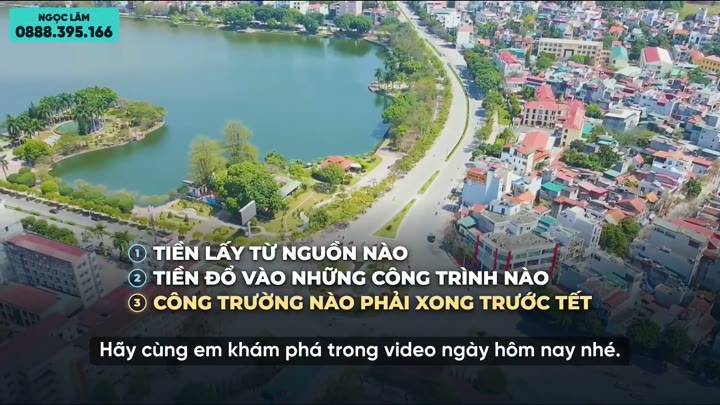
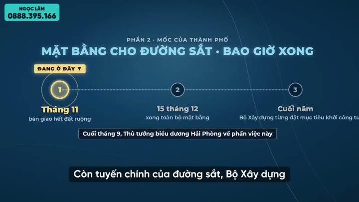
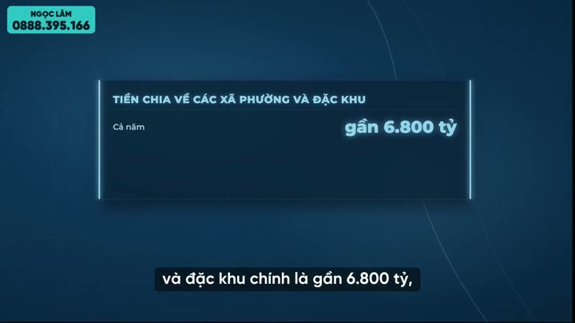

# Ghi chú video mẫu — "Hơn 46 nghìn tỷ đầu tư công của Hải Phòng năm 2026 đi vào đâu"

## 1. Thông tin
- Tiêu đề gốc: Hơn 46 nghìn tỷ đầu tư công của Hải Phòng năm 2026 đi vào đâu
- Nền tảng: Facebook (video trang Ngọc Lâm BĐS), ngang 16:9
- Ngày đăng: 31/10/2026
- Thời lượng: 6:07 (366,9 giây)
- Lượt xem: 4.026 (thấp nhất trong nhóm video "số liệu thành phố")
- Link: https://www.facebook.com/watch/?v=1126682179748367

## 2. Một câu
Tiền đầu tư công 46.000 tỷ của Hải Phòng năm nay lấy từ đâu và đi vào 5 chỗ nào: mặt bằng đường sắt, 5 công trường trung tâm, đường ngoài trung tâm, tiền chia về xã phường, hai quỹ.

## 3. Format
**Một con số lớn của thành phố đi đâu** (tiền, chia thành 5 phần, mỗi phần một nhóm công trình, có hạn "xong trước Tết").

## 4. Mở đầu (hook)
> "Hơn 46.000 tỷ đồng tiền ngân sách của Hải Phòng năm nay đang đổ vào những công trình nào. Tới cuối tháng 10, thành phố đã tiêu 33.000 tỷ trong số đó, nhiều thứ 3 cả nước. Chỉ sau Hà Nội và Hồ Chí Minh, có hơn 3.800 tỷ đi vào mặt bằng cho tuyến đường sắt Lào Cai, Hà Nội, Hải Phòng."

Công thức hook: **một con số rất lớn + một thứ hạng (thứ 3 cả nước) + 3 khoản chi tiêu biểu + câu hỏi "số còn lại đi đâu, công trường nào phải xong trước"**.

## 5. Cấu trúc (theo SRT)
- 00:00 Hook: 46.000 tỷ, 33.000 tỷ đã tiêu, các khoản lớn
- 00:30 (khoảng) Chào + video nói gì
- 00:46 Số tổng: đã tiêu 33.064 tỷ, 89% kế hoạch (cả nước gần 66%)
- 01:03 Phần 1. Tiền từ đâu ra: Trung ương hơn 2.000 tỷ, còn lại tiền thành phố; so với 5 năm trước
- 01:46 Phần 2. Mặt bằng cho tuyến đường sắt (gần 105 km, 22 khu tái định cư, mốc 15/12)
- 02:48 Phần 3. 5 công trường lớn ở trung tâm (vành đai 2, cầu Nguyễn Trãi, đường nối QL5 – QL10, 3 hầm chui)
- 04:02 Phần 4. Những con đường ngoài trung tâm (Vĩnh Bảo, cầu Tân An, Tiên Lãng, ven biển)
- 04:48 Phần 5. Tiền về từng xã phường (gần 6.800 tỷ) và hai quỹ
- 05:25 "Và có thể thấy…" 3 việc chính + "tuy nhiên còn hơn 13.000 tỷ phải tiêu trong khi đất ở cho đường sắt mới xong hơn 10%"
- 05:47 Câu hỏi bình luận + like/đăng ký + cảm ơn

## 6. Hình ảnh
Contact sheet 12 khung đã xem. Phong cách:
- Nền xanh navy, đồ hoạ vẽ sơ đồ: đường ray chạy từ Lào Cai – Hà Nội – Hải Phòng, mặt cắt hầm chui, cầu dây văng, thanh tiến độ.
- Thẻ số liệu lớn (ví dụ "hơn 38.700 tỷ / hơn 7.000 tỷ / gần 36.800 tỷ"; "Đã xong 75% diện tích · đất ruộng: gần xong · đất ở mới được hơn 10%").
- Xen flycam thật: công trường cầu, trường học, quảng trường; có dòng ghi "ảnh minh hoạ" ở một số cảnh.
- Thanh nhãn "NGỌC LÂM 0888.395.166" góc trên trái, phụ đề trắng dưới giữa.
- Ba khung đã lưu: `anh-01.jpg`, `anh-02.jpg`, `anh-03.jpg`.

  

## 7. Cách đặt tiêu đề & mô tả
**Tiêu đề:** "[Số tiền lớn] [loại tiền] của [thành phố] năm [năm] đi vào đâu". Công thức: *số lớn + năm cụ thể + câu hỏi "đi vào đâu"*.

**Mô tả Facebook:**
1. Dòng đầu nêu câu hỏi.
2. Đoạn số: tiêu 33.064 tỷ, 89% kế hoạch, cả nước 66%, chỉ sau Hà Nội và TP HCM.
3. Đoạn 2 khoản lớn: 3.800 tỷ mặt bằng đường sắt (gần 105 km), gần 6.800 tỷ chia về xã phường.
4. Hashtag (#haiphong #dautucong #duongsatlaocaihanoihaiphong #vanhdai2 #ngoclambds).
Không chapter, không link, không số điện thoại, không dòng nguồn.

## 8. Lời kêu gọi (CTA)
> "Còn theo anh chị, trong những công trình kể trên, công trình nào mà anh chị mong xong sớm nhất? Hãy để lại ý kiến phần bình luận nhé!"

Rồi lời xin like và đăng ký chuẩn.

## 9. Số liệu & nguồn
(Whisper chép "năm 2016" ở câu chào là nhầm; phải là 2026.)
- 46.000 tỷ (Trung ương hơn 2.000, còn hơn 44.000 là tiền thành phố); Thủ tướng giao hơn 38.700 tỷ, thành phố thêm hơn 7.000 tỷ.
- Tới 25/10 tiêu 33.064 tỷ, 89% kế hoạch (cả nước gần 66%); thứ 3 về số tiền sau Hà Nội, TP HCM.
- 5 năm 2021 – 2025: hơn 138.000 tỷ; hai phần ba là tiền từ đất.
- Đường sắt: 3.800 tỷ năm nay; gần 105 km; gần 450 ha đất, khoảng 5.650 hộ; tổng chi ước 11.000 tỷ; 22 khu tái định cư; xong 75% diện tích tới 26/10.
- Vành đai 2: hơn 2.300 tỷ, tiêu 84%; cầu Nguyễn Trãi hơn 1.000 tỷ, tổng 6.313 tỷ, đã tiêu 4.344 tỷ; thông xe trước 31/1, xong trước 30/4/2027; tiền về xã phường 6.800 tỷ, tiêu 5.276 tỷ (gần 78%).
- Còn hơn 13.000 tỷ phải tiêu tới cuối năm.
- **Nguồn:** chỉ nêu chung ("kế hoạch Thủ tướng giao", "Bộ Xây dựng đặt mục tiêu"), không đọc tên văn bản hay báo cáo nào.

## 10. Làm cho Hạ Long Xanh / Quảng Ninh
**Gợi ý tiêu đề:**
1. "Quảng Ninh năm 2026 có bao nhiêu tiền đầu tư công, đang đổ vào những công trình nào? [cần tra]"
2. "Đầu tư công Quảng Ninh: 5 công trình sẽ thay đổi đường vào Hạ Long"
3. "Tàu cao tốc, đường ven biển, cầu: tiền công của Quảng Ninh đang chảy về Hạ Long ra sao?"

**Chị Linh phải làm thật:**
- Tìm kế hoạch vốn đầu tư công năm 2026 của Quảng Ninh, số đã giải ngân tới một ngày cụ thể, tỷ lệ so với cả nước [cần tra: Sở Tài chính Quảng Ninh, báo cáo UBND tỉnh, Bộ Tài chính, báo chính thống; ghi ngày].
- Danh sách 4 – 5 công trình lớn gần Hạ Long [cần tra], trong đó có thể có tàu cao tốc Cổ Loa – Hạ Long (khởi công 12/4/2026, khoảng 120 km, dự kiến xong cuối 2028; hỏi lại xem phần vốn này có tính là đầu tư công không, vì vốn tuyến này có thể không phải ngân sách [cần tra: nguồn vốn]).
- Quay công trường thật hoặc dùng ảnh có nguồn.

**Phải kiểm:** đây là loại số liệu dễ sai nhất (số kế hoạch, số giải ngân, ngày chốt). Mỗi con số kèm "tính đến ngày …". Không gộp vốn đầu tư công với vốn doanh nghiệp.

**Lưu ý:** video này ít người xem (4.026) so với video xếp hạng và hạ tầng cùng kênh; chị Linh nên làm sau các format đó.
