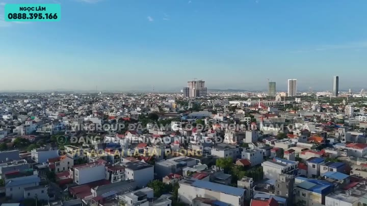
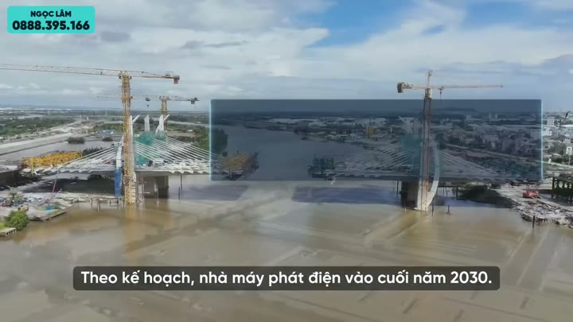
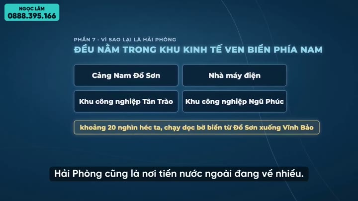

# Ghi chú video mẫu — "Vì sao Vingroup đổ hơn nửa triệu tỷ đồng vào Hải Phòng"

## 1. Thông tin
- Tiêu đề gốc: Vì sao Vingroup đổ hơn nửa triệu tỷ đồng vào Hải Phòng
- Nền tảng: Facebook (video trang Ngọc Lâm BĐS), ngang 16:9
- Ngày đăng: 07/11/2026
- Thời lượng: 6:21 (380,7 giây)
- Lượt xem: 43.126
- Link: https://www.facebook.com/watch/?v=1129140306152856

## 2. Một câu
Vingroup đã có gì ở Hải Phòng hơn 10 năm qua và đang làm hoặc muốn làm 5 thứ nào (cảng, nhà máy điện khí, khu đô thị, hai khu công nghiệp, đường sắt cao tốc), tổng hơn nửa triệu tỷ, và vì sao lại là Hải Phòng.

## 3. Format
**Một chủ đầu tư lớn đang làm gì ở thành phố** (liệt kê "5 thứ", rồi trả lời "vì sao ở đây").

## 4. Mở đầu (hook)
> "Vì sao Vingroup lại chọn Hải Phòng để đặt những dự án lớn nhất của mình? Bởi Vingroup đã có mặt ở Hải Phòng hơn 10 năm, từ phố cũ ra tới ngoài đảo... Cộng những dự án đang làm với những dự án muốn làm, số tiền lên tới hơn nửa triệu tỷ đồng, số đó gấp hơn 12 lần tiền ngân sách thành phố bỏ ra làm công trình trong cả năm nay."

(Whisper chép "Virup", "Vin Group"; tên đúng là Vingroup theo tiêu đề và mô tả.)

Công thức hook: **câu hỏi "vì sao" + tên thương hiệu lớn + con số rất lớn + một phép so sánh làm con số dễ hình dung (gấp hơn 12 lần ngân sách thành phố)**.

## 5. Cấu trúc (theo SRT)
- 00:00 Hook
- 00:30 Chào + nêu 3 câu hỏi (đã làm gì, đang đổ tiền vào đâu, vì sao Hải Phòng)
- 00:47 Phần 1. Vingroup có gì ở Hải Phòng: Vincom 10/2015, Vinhomes Imperia 2017, Marina, nhà máy ô tô Cát Hải 335 ha, cầu Hoàng Gia
- 01:47 Phần 2. Thứ nhất: cảng Nam Đồ Sơn (4.300 ha, hơn 370.000 tỷ, 3 đợt tới 2040)
- 02:15 Phần 3. Thứ hai: nhà máy điện khí (hơn 178.000 tỷ, 4.800 MW, xong cuối 2030)
- 03:00 Phần 4. Thứ ba: khu đô thị Vinhomes Golden City (240 ha, hơn 23.000 tỷ)
- 03:36 Phần 5. Thứ tư: hai khu công nghiệp Tân Trào và Ngũ Phúc
- 04:14 Phần 6. Thứ năm: đường sắt cao tốc Hà Nội – Quảng Ninh (hơn 147.000 tỷ, khoảng 120 km, 5 ga, mốc 2028)
- 04:52 Phần 7. Vì sao lại là Hải Phòng: khu kinh tế ven biển phía Nam, vốn nước ngoài, thu ngân sách
- 05:37 "Và có thể thấy…" tóm tắt + "gần 2/3 số tiền chỉ vào công trường khi thành phố duyệt cảng Nam Đồ Sơn"
- 05:58 Câu hỏi bình luận + like/đăng ký
- 06:17 Whisper nghe thêm một câu "Hãy subscribe cho kênh Ghiền Mì Gõ…": đây là phần lạc từ nhạc/đuôi, bỏ qua, không phải lời Ngọc Lâm.

## 6. Hình ảnh
Contact sheet 12 khung đã xem. Phong cách:
- Nền xanh navy đồ hoạ: đường mốc thời gian 2015 – nay, mặt cắt tàu và cẩu cảng, tàu cao tốc "120 CÂY SỐ · 5 GA · TÀU CHẠY 350 CÂY SỐ MỘT GIỜ" (số đọc trên hình), sơ đồ "5 thứ nằm trong khu kinh tế ven biển phía Nam".
- Thẻ tiêu đề từng phần ("THỨ NHẤT · CẢNG NAM ĐỒ SƠN", "THỨ HAI · NHÀ MÁY ĐIỆN KHÍ HẢI PHÒNG").
- Xen flycam thật: cửa sông, công trường cầu, khu đô thị Vinhomes.
- Thanh nhãn "NGỌC LÂM 0888.395.166" góc trên trái, phụ đề trắng dưới giữa.
- Ba khung đã lưu: `anh-01.jpg`, `anh-02.jpg`, `anh-03.jpg`.

  

## 7. Cách đặt tiêu đề & mô tả
**Tiêu đề:** "Vì sao [tên tập đoàn] đổ hơn [số lớn] vào [thành phố]". Công thức: *"vì sao" + tên người chơi lớn + số tiền "nửa triệu tỷ" + động từ mạnh "đổ"*. Có số, có nhân vật, có bí ẩn.

**Mô tả Facebook:**
1. Dòng đầu = tiêu đề.
2. Đoạn lịch sử ngắn (từ 10/2015, khu đô thị 2017, nhà máy ô tô Cát Hải 335 ha).
3. Đoạn nói rõ "5 thứ" và số tiền (nhà máy điện khí hơn 178 nghìn tỷ, đường sắt hơn 147 nghìn tỷ), nhắc "phần lớn nằm ở nửa phía Nam".
4. Hashtag (#haiphong #vingroup #vinhomes #nhamaydienkhi #ngoclambds).

## 8. Lời kêu gọi (CTA)
> "Còn theo anh chị, trong năm thứ đó, thứ nào đổi nhiều nhất cho Hải Phòng, cảng biển, nhà máy điện hay khu đô thị? Hãy để lại ý kiến phần bình luận nhé!"

Câu hỏi chọn 1 trong 3.

## 9. Số liệu & nguồn
- Vingroup ở Hải Phòng từ 10/2015 (Vincom, đường Lê Thánh Tông); khu đô thị 2017 (78,5 ha), Marina 49 ha; nhà máy ô tô Cát Hải 335 ha; cầu Hoàng Gia hơn 2.300 tỷ.
- Hơn nửa triệu tỷ tổng; gấp hơn 12 lần ngân sách công trình cả năm; cảng 370.000 tỷ, gấp gần 8 lần.
- Nhà máy điện khí: gần 100 ha, hơn 178.000 tỷ, 4.800 MW, đợt đầu 1.600 MW; xong cuối 2030.
- Golden City: 240 ha, hơn 23.000 tỷ; Tân Trào 227 ha; Ngũ Phúc 238 ha, hơn 5.670 tỷ.
- Đường sắt cao tốc: hơn 147.000 tỷ, khoảng 120 km, 5 ga, 350 km/giờ, khởi công tháng 4 năm nay ở Quảng Ninh, mốc 2028; Hà Nội tới Hạ Long 23 phút.
- Vốn nước ngoài tháng 10: hơn 3,8 tỷ USD, tăng 69%; thu ngân sách 10 tháng hơn 180.000 tỷ.
- **Nguồn:** không đọc tên nguồn nào cho các số này (chỉ nói "theo kế hoạch", "theo thiết kế"). Số nhiều, dễ sai nếu không kiểm chéo.

## 10. Làm cho Hạ Long Xanh / Quảng Ninh
**Gợi ý tiêu đề:**
1. "Vì sao Vinhomes chọn Tuần Châu – Hà An để làm Hạ Long Xanh? Và họ đang làm gì ở Quảng Ninh"
2. "Hạ Long Xanh, tàu cao tốc, [dự án khác]: 3 thứ nằm gần nhau ở Quảng Ninh [cần tra]"
3. "Global Gate Hạ Long khởi công 19/12/2025: bây giờ đang tới bước nào?"

**Dùng được sự thật có nguồn:** Hạ Long Xanh / Global Gate Hạ Long ở phường Tuần Châu và Hà An, khởi công 19/12/2025; tàu cao tốc Cổ Loa – Hạ Long khởi công 12/4/2026, khoảng 120 km, dự kiến xong cuối 2028 (video mẫu cũng nhắc tuyến này).

**Chị Linh phải làm thật:**
- Tự lập danh sách dự án thật của chủ đầu tư ở Quảng Ninh, kèm vốn, diện tích, mốc [cần tra: quyết định chủ trương, thông tin công bố của chủ đầu tư].
- Một đoạn "vì sao Quảng Ninh" bằng số thật có nguồn [cần tra: vốn FDI, thu ngân sách, lượt khách; ghi nguồn và ngày].
- Cảnh thật từ công trường Hạ Long Xanh (xin phép chủ đầu tư nếu cần) và từ tuyến tàu.

**Phải kiểm:** diện tích, tổng vốn, số căn của Hạ Long Xanh [cần tra]; tuyên bố tương lai (xong năm nào) phải ghi "theo kế hoạch/theo công bố của chủ đầu tư".

**Lưu ý trung thực:** video mẫu nói về chủ đầu tư như một nhà phân tích bên ngoài. Chị Linh đang bán dự án của chính chủ đầu tư này, nên phải nói rõ "Linh là đơn vị phân phối/tư vấn dự án", không trình bày như bài nhận xét khách quan. Không dùng số tiền khổng lồ để ngầm hứa tăng giá.
