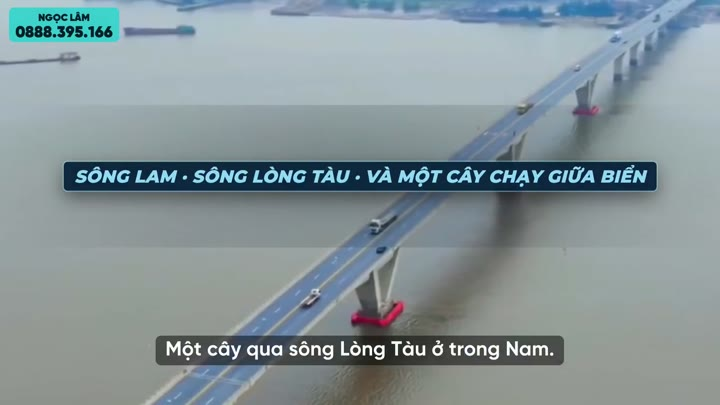
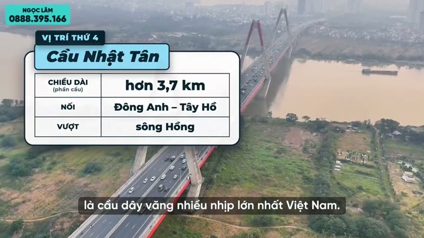
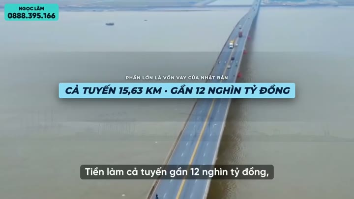

# Ghi chú video mẫu — "6 cây cầu dài nhất Việt Nam"

## 1. Thông tin
- Tiêu đề gốc: 6 cây cầu dài nhất Việt Nam
- Nền tảng: Facebook (video trang Ngọc Lâm BĐS), ngang 16:9
- Ngày đăng: 04/11/2026
- Thời lượng: 6:24 (384,4 giây)
- Lượt xem: 14.232
- Link: https://www.facebook.com/watch/?v=1673667400810994

## 2. Một câu
Xếp 6 cây cầu dài nhất Việt Nam từ thứ 6 lên thứ 1 (cầu Tân Vũ – Lạch Huyện của Hải Phòng đứng đầu), kể mỗi cầu dài bao nhiêu, nối đâu, ai đi qua, và cầu Hòn Khoai ở Cà Mau sắp vượt lên.

## 3. Format
**Xếp hạng / top N** (đếm ngược từ thứ 6, mỗi hạng một đoạn đều nhau, kết bằng "ngôi đầu sắp đổi chủ").

## 4. Mở đầu (hook)
> "Những cây cầu dài nhất Việt Nam đang nằm ở những đâu. Bởi 6 cây cầu dài nhất nước mình đều ở 3 miền. Từ cây cầu vượt sông Lam nối Nghệ An với Hà Tĩnh, đến cây cầu vượt sông Lòng Tàu mới thông xe hồi tháng 9 năm nay trong Nam, và cả một cây cầu chạy giữa biển ngoài Hải Phòng. Cây cầu đứng đầu dài hơn 5 km nhưng ngôi đầu sắp đổi chủ."

(Whisper chép sai vài từ: "sông Nam" = sông Lam; "hời của tháng 9" = thông xe hồi tháng 9. Theo đoạn sau và mô tả.)

Công thức hook: **câu hỏi "nằm ở đâu" + 3 ví dụ rải ba miền + con số đứng đầu + lời hứa bất ngờ "ngôi đầu sắp đổi chủ"**.

## 5. Cấu trúc (theo SRT)
- 00:00 Hook
- 00:21 Chào + nói video làm gì (mỗi cầu dài bao nhiêu, nối đâu, người đi về hướng nào)
- 00:38 Tổng quan: 3 cầu qua sông Hồng, 1 qua sông Lam, 1 qua sông Lòng Tàu, 1 giữa biển; ngắn nhất 3,1 km, đứng đầu 5,44 km
- 01:06 Vị trí thứ 6: cầu Phước Khánh (Hồ Chí Minh – Đồng Nai), hơn 3,1 km, thông xe 30/9
- 02:04 Vị trí thứ 5: cầu Vĩnh Tuy, Hà Nội, gần 3,7 km
- 02:42 Vị trí thứ 4: cầu Nhật Tân, hơn 3,7 km, 5 trụ tháp
- 03:17 Vị trí thứ 3: cầu Hưng Đức (Nghệ An – Hà Tĩnh), gần 4,1 km
- 04:05 Vị trí thứ 2: cầu Vĩnh Thịnh (Hà Nội – Phú Thọ), phần cầu 4.480 m
- 04:50 Vị trí thứ 1: cầu Tân Vũ – Lạch Huyện, 5,44 km, Hải Phòng
- 05:39 "Và có thể thấy…" tóm tắt (3 cầu qua sông Hồng, số 1 ở Hải Phòng)
- 05:50 Bất ngờ: cầu Hòn Khoai ở Cà Mau (hơn 17 km, khởi công 8/2025, xong cuối 2028) sẽ thành cầu dài nhất
- 06:06 Câu hỏi bình luận + like/đăng ký + cảm ơn

(Ghi chú: Whisper chép tên cầu khá sai; tên cầu lấy theo thẻ chữ trên hình và mô tả: Phước Khánh, Vĩnh Tuy, Nhật Tân, Hưng Đức, Vĩnh Thịnh, Tân Vũ – Lạch Huyện.)

## 6. Hình ảnh
Contact sheet 12 khung đã xem. Phong cách **flycam thật từng cây cầu**, không đồ hoạ nền xanh:
- Thẻ chữ nhấn ngay trên cảnh (nền xanh navy, chữ vàng/xanh nổi): "CÂY ĐỨNG ĐẦU DÀI HƠN 5 CÂY SỐ", "5 TRỤ THÁP LÀ 5 CỬA Ô CỦA HÀ NỘI", "CẦU VĨNH THỊNH, CẦU VƯỢT SÔNG DÀI NHẤT VIỆT NAM".
- Thẻ số liệu nhỏ trong khung (chiều dài, nối đâu).
- Ảnh/tư liệu thật (biển tên cầu "Cầu Vĩnh Thịnh", ghi vốn vay Hàn Quốc).
- Cảnh cuối: bản đồ/đảo và cảng container.
- Thanh nhãn "NGỌC LÂM 0888.395.166" góc trên trái, phụ đề trắng dưới giữa.
- Ba khung đã lưu: `anh-01.jpg`, `anh-02.jpg`, `anh-03.jpg`.

  

## 7. Cách đặt tiêu đề & mô tả
**Tiêu đề:** "6 cây cầu dài nhất Việt Nam". Công thức: *số + loại + "dài nhất" + quốc gia*. Ngắn, dễ nhớ, đúng kiểu người ta hay tìm.

**Mô tả Facebook:**
1. Câu hỏi có gắn địa phương của kênh ("nằm ở đâu, và Hải Phòng góp cây nào").
2. Đoạn phân bố 6 cầu (3 sông Hồng, 1 sông Lam, 1 sông Lòng Tàu, 1 giữa biển) + "cây ngắn nhất 3,1 km, cây đứng đầu 5,44 km" + "nhưng ngôi đầu sắp đổi chủ".
3. Hashtag (#haiphong #caudainhat #cautanvulachhuyen #hatanggiaothong #ngoclambds).
Điểm khéo: video xếp hạng cả nước nhưng mô tả gắn lại với Hải Phòng (kênh làm bất động sản Hải Phòng).

## 8. Lời kêu gọi (CTA)
> "Còn theo anh chị, cây cầu nào mà anh chị đi qua và thấy ấn tượng nhất? Hãy để lại ý kiến phần bình luận nhé!"

## 9. Số liệu & nguồn
- Phước Khánh hơn 3,1 km; tháp cao khoảng 155 m, nhịp chính 300 m, tĩnh không 55 m; thông xe 30/9 sau hơn 12 năm.
- Vĩnh Tuy gần 3,7 km; cầu thứ hai thông xe tháng 8/2023, hơn 2.500 tỷ.
- Nhật Tân hơn 3,7 km, 5 trụ tháp, 6 nhịp dây văng; khánh thành 4/1/2015.
- Hưng Đức gần 4,1 km, khoảng 1.300 tỷ, thông xe 30/6/2024.
- Vĩnh Thịnh phần cầu 4.480 m, tổng tuyến hơn 5,4 km, 137 triệu USD (100 triệu vay Hàn Quốc), khánh thành 8/6/2014.
- Tân Vũ – Lạch Huyện 5,44 km, tuyến 15,63 km, gần 12.000 tỷ, vay Nhật là chính; thông xe 2/9/2017.
- Cầu Hòn Khoai hơn 17 km, hơn 25.700 tỷ, khởi công 8/2025, dự kiến cuối 2028.
- **Nguồn:** không đọc tên nguồn nào; số liệu công khai nhưng video không nêu cơ quan.

## 10. Làm cho Hạ Long Xanh / Quảng Ninh
**Gợi ý tiêu đề:**
1. "Những cây cầu lớn nhất Quảng Ninh: cầu nào đưa anh chị tới Hạ Long?"
2. "5 cây cầu dài nhất Quảng Ninh, cây nào gần Hạ Long Xanh nhất? [cần tra: danh sách và chiều dài]"
3. "Từ Hà Nội tới Hạ Long qua mấy cây cầu? Đi theo tàu cao tốc Cổ Loa – Hạ Long sẽ qua những cầu nào?"

**Chị Linh phải làm thật:**
- Lập danh sách cầu lớn của Quảng Ninh và đường tới Hạ Long, kèm chiều dài, năm thông xe, vốn [cần tra: từng cầu; tự kiểm bằng nguồn của Sở Giao thông, báo chính thống].
- Quay flycam hoặc dùng ảnh có bản quyền từng cầu; thẻ chữ nhấn như video mẫu.
- Một đoạn "người đi qua cầu để làm gì" kể bằng người thật (người đi làm, khách du lịch, xe hàng).

**Phải kiểm:** từng số "dài nhất", "xếp thứ mấy" cần có nguồn tổng hợp (ví dụ danh sách của một cơ quan hoặc báo uy tín) [cần tra]. Không viết "dài nhất" nếu chưa chắc.

**Lưu ý:** đây là format dễ làm mà ít rủi ro nhất cho người mới, vì chỉ cần danh sách và hình đẹp, không cần nói về bán hàng.
