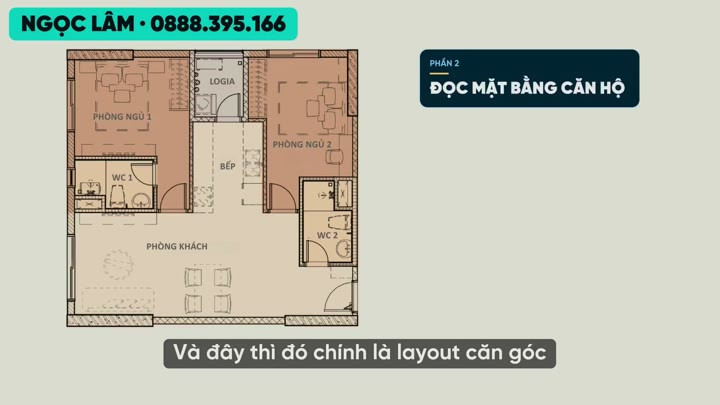
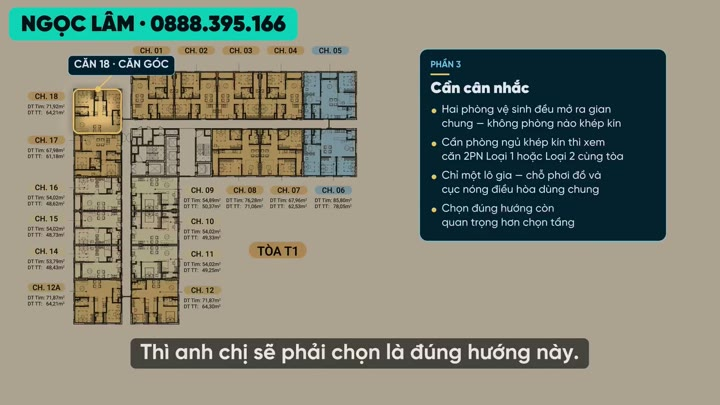

# Ghi chú video mẫu — "Review layout căn góc 2 phòng ngủ loại 4 AnZen Residences"

## 1. Thông tin
- Tiêu đề gốc: Review layout căn góc 2 phòng ngủ loại 4 AnZen Residences
- Nền tảng: Facebook (video trang Ngọc Lâm BĐS), ngang 16:9
- Ngày đăng: 16/11/2026
- Thời lượng: 13:57 (836,5 giây), dài nhất trong nhóm
- Lượt xem: 338 (thấp nhất nhóm; đây là video bán hàng trực tiếp, chưa rõ vì sao ít người xem)
- Link: https://www.facebook.com/watch/?v=1805498764061718
- Ghi chú tên: Whisper chép "Angele DGD" = **AnZen** (mô tả và tiêu đề xác nhận); "Võng Sản" = Bất Động Sản; "loại 4" nghe thành "lợi 4".

## 2. Một câu
Đọc mặt bằng căn góc 2 phòng ngủ loại 4 toà T1 AnZen Residences (thông thuỷ khoảng 64,2 m²): ưu điểm, nhược điểm, hướng và view, danh mục bàn giao, giá, ưu đãi, tiến độ thanh toán.

## 3. Format
**Đọc mặt bằng một loại căn** (và chốt bằng giá, chính sách).

## 4. Mở đầu (hook)
> "Khám phá căn 2 phòng ngủ loại 4 tại dự án AnZen này vâng. Vâng, và xin chào quý cô chú anh chị đã quay trở lại với kênh YouTube của Ngọc Lâm. Trong video ngày hôm nay, em sẽ đưa quý cô chú anh chị xem layout mặt bằng của căn 2 phòng ngủ loại 4, xem có gì đặc biệt ạ, và các phương thức thanh toán cũng như chiết khấu chủ đầu tư dành cho khách hàng ở thời điểm hiện tại."

(Whisper chép sai: "lợi 4", "Angele DGD", "chất khấu chủ tư" = chiết khấu chủ đầu tư.)

Công thức hook: **không có hook bất ngờ.** Đây là video "tên gọi đúng việc": nói thẳng sẽ xem gì (mặt bằng, thanh toán, chiết khấu) rồi vào việc. Hợp với khách đã quan tâm dự án, không hợp để kéo người lạ.

## 5. Cấu trúc (theo SRT)
- 00:00 Giới thiệu, nói sẽ xem gì
- 00:28 Toà T1 cao 18 tầng, từ tầng 3 là căn ở; mỗi sàn 18 căn, 3 căn góc (12, 12A, 18), cả toà 48 căn góc
- 00:57 Diện tích: thông thuỷ khoảng 64,2 – 64,3 m², tim tường gần 72 m², rộng hơn căn 2PN phổ biến khoảng 3 m², dồn vào phòng khách
- 01:38 Mặt bằng: cửa chính, phòng khách ở góc 2 mặt cửa sổ (điểm đáng giá nhất)
- 02:42 Hai phòng ngủ tách hai đầu, bếp ở giữa; hai phòng vệ sinh; lô gia có mái che, máy giặt
- 04:22 Căn loại 3 hết, chỉ còn loại 4
- 04:48 Ưu điểm: 2 mặt thoáng; hai phòng ngủ tách xa, đỡ ồn
- 05:13 Nhược điểm: 2 WC mở ra không gian chung (không WC khép kín trong phòng ngủ), chỉ 1 lô gia, chung chỗ phơi và cục nóng
- 06:05 Chọn hướng và tầng (nắng hè); mở lại tổng mặt bằng 3 căn góc
- 07:22 Hướng và tầm view: 4 hướng, 5 nhóm view (nội khu, đường trục, sông Bạch Đằng…)
- 08:38 Danh mục bàn giao: hoàn thiện cơ bản (gạch khổ lớn phòng khách, gỗ công nghiệp phòng ngủ); khách tự sắm tủ bếp trên, điều hoà, rèm, đèn; căn hộ mẫu
- 09:28 Ưu đãi: tối đa 22% nếu thanh toán theo tiến độ (12% cơ bản + 10% đón Tết cho 20 căn đầu, trước 30/11)
- 10:45 Giá căn 18 tầng 3: 2,11 tỷ (giá gốc, chưa trừ chiết khấu, chưa thuế, chưa 2% bảo trì); sau ưu đãi 1,931 tỷ
- 11:35 Phương án vay ngân hàng: 15% ưu đãi, hỗ trợ lãi suất tối đa 9%/năm trong 12 tháng, vay tối đa 65%; tổng 2,104 tỷ
- 12:00 Tiến độ thanh toán 4 mốc (cọc 50 triệu; 10%; 10%; 75% khi nhận nhà; 5% khi cấp sổ)
- 12:50 Bàn giao tháng 12/2026; miễn phí quản lý 18 tháng
- 13:40 Chốt: liên hệ qua số điện thoại để nhận bảng giá và chính sách mới nhất; cảm ơn

## 6. Hình ảnh
Contact sheet 12 khung đã xem. Phong cách:
- **Gần như cả video là bản vẽ mặt bằng** trên nền màu kem/xám, khoanh vùng bằng khung màu và nhãn ngay trên bản vẽ ("PHÒNG NGỦ 2 · TỦ + CỬA SỔ RIÊNG", "MÁY GIẶT KÊ SẴN TRONG LÔ GIA", "HAI PHÒNG NGỦ TÁCH ĐẦU").
- Thẻ thông tin góc trên phải, nền xanh navy: "Căn góc số 18 · 2 phòng ngủ – 2 WC · Thông thuỷ 64,2 – 64,3 m² · Tim tường gần 72 m²"; thẻ "Điểm mạnh", "Cần cân nhắc", "Ưu đãi còn 15%…".
- Tổng mặt bằng toà T1 có đánh dấu vị trí căn góc (tô vàng).
- **Cảnh cuối là người nói trước ống kính** (Ngọc Lâm ngồi trong căn hộ mẫu): khung duy nhất có mặt người trong cả nhóm.
- Thanh nhãn "NGỌC LÂM · 0888.395.166" nằm ngang góc trên trái, phụ đề trắng dưới giữa.
- Ba khung đã lưu: `anh-01.jpg` (tổng quan toà), `anh-02.jpg` (giữa), `anh-03.jpg` (người nói, cảnh cuối).

  

## 7. Cách đặt tiêu đề & mô tả
**Tiêu đề:** "Review layout căn [vị trí] [số phòng ngủ] loại [số] [tên dự án]". Công thức: *việc làm (review layout) + loại căn rất cụ thể + tên dự án*. Người tìm kiếm dự án sẽ gõ đúng cụm này; không dành cho người lạ.

**Mô tả Facebook:**
1. Câu đầu lặp lại tiêu đề và gắn thành phố.
2. Đoạn số: toà T1 18 tầng; 18 căn/sàn, 3 căn góc, 48 căn góc; thông thuỷ 64,2 – 64,3 m², tim tường gần 72 m², rộng hơn 3 m²; "phần rộng thêm dồn hết vào phòng khách".
3. **Link bảng giá** trên vungoclam.com (`/anzen-residences/`).
4. Hashtag (#haiphong #anzenresidences #cangoc2phongngu #layoutcanho #ngoclambds #Anzen).
Không có chapter, không có "nói cho công bằng" trong mô tả (phần nhược điểm nằm trong video).

## 8. Lời kêu gọi (CTA)
Hai lần:
> "Và trước khi vào video, quý cô chú anh chị cho em xin 1 like và 1 đăng ký kênh" (đầu video)
> "Nếu quý cô chú anh chị nào mà đang quan tâm tới dự án, có thể liên hệ em qua số điện thoại 088 395 166, em sẽ gửi bảng giá cũng như thanh toán mới nhất từ chủ đầu tư cho mình tham khảo ạ" (cuối video)

Mô tả: link bảng giá vungoclam.com. Đây là video **duy nhất trong nhóm có CTA bán hàng ngay trong lời nói** (các video khác chỉ xin bình luận, like, đăng ký).

## 9. Số liệu & nguồn
(Đây là loại số liệu của chủ đầu tư, có ngày hết hạn. Chị Linh phải lấy từ bảng hàng và chính sách bán hàng chính thức của chủ đầu tư.)
- Toà T1: 18 tầng; tầng 3 – 18 là căn ở; 18 căn/sàn; 3 căn góc; 48 căn góc.
- Căn góc: thông thuỷ 64,2 – 64,3 m² (căn 18 tầng 3: 64,21 m²); tim tường gần 72 m².
- Giá căn 18 tầng 3: 2 tỷ 110 triệu (giá gốc chưa chiết khấu, chưa thuế, chưa phí bảo trì).
- Ưu đãi: 22% khi thanh toán theo tiến độ (12% cơ bản + 10% thêm cho 20 căn đầu trước 30/11); 15% khi vay ngân hàng.
- Sau ưu đãi 22% + thuế + 2% bảo trì: 1 tỷ 931 triệu. Vay: 2 tỷ 104 triệu.
- Hỗ trợ lãi suất tối đa 9%/năm trong 12 tháng; vay tối đa 65%.
- Tiến độ: cọc 50 triệu; 7 ngày ký hợp đồng, nộp 10%; sau 1 tháng nộp 10%; khi nhận nhà nộp 75%; 5% cuối khi cấp sổ. Bàn giao tháng 12/2026; miễn phí quản lý 18 tháng, kéo dài tối đa tới tháng 5/2028.
- **Nguồn:** nói "chủ đầu tư", "chính sách từ cuối tháng này"; không đọc tên văn bản. Mô tả đưa link bảng giá.

## 10. Làm cho Hạ Long Xanh / Quảng Ninh
**Gợi ý tiêu đề:**
1. "Review layout căn [loại căn] [toà] Hạ Long Xanh: ưu điểm, nhược điểm, ai nên chọn"
2. "Đọc mặt bằng căn [x] phòng ngủ Global Gate Hạ Long trong 10 phút"
3. "Căn góc hay căn giữa ở Hạ Long Xanh? Linh chỉ ra 3 điểm trên bản vẽ"

**Chị Linh phải làm thật:**
- Lấy mặt bằng tầng và mặt bằng căn **chính thức** của chủ đầu tư; không vẽ lại từ trí nhớ.
- Tự đi xem căn mẫu, nhà mẫu hoặc công trường nếu có. Nếu chưa có căn thật thì nói thẳng như video mẫu ("chưa có căn thật, chỉ xem trên bản vẽ").
- Nói đủ ưu, nhược; nhược điểm là phần tạo tin cậy (ví dụ WC mở ra không gian chung, 1 lô gia).
- Danh mục bàn giao ghi bằng chữ đúng hợp đồng mẫu.

**Phải kiểm (đều [cần tra] từ nguồn chính thức, ghi ngày):** diện tích thông thuỷ/tim tường từng loại căn; giá; chính sách chiết khấu và điều kiện; tiến độ thanh toán; thời gian bàn giao; phí quản lý, bảo trì; pháp lý (giấy phép, bảo lãnh ngân hàng, sổ). Chính sách thường hết hạn, nên ghi "áp dụng đến ngày …".

**Lưu ý trung thực:** không bê nguyên các con số của AnZen (Hải Phòng). Không nói "chỉ còn 1 căn" nếu chưa kiểm bảng hàng. Không dựng "ưu đãi sắp hết" để ép khách.

**Lưu ý hiệu quả:** video này chỉ có 338 lượt xem. Dùng như video **dành cho khách đã hỏi** (gửi link qua Zalo), không phải video kéo khách mới.
