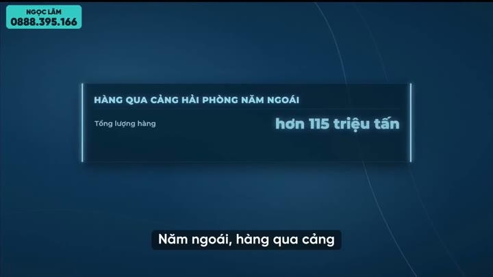
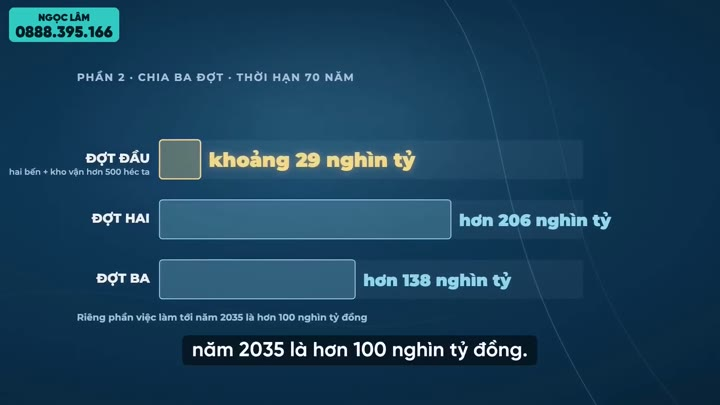
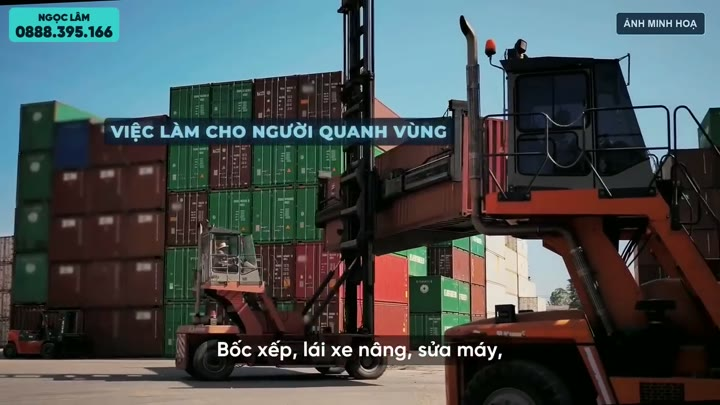

# Ghi chú video mẫu — "Cảng Nam Đồ Sơn Hải Phòng hơn 370 nghìn tỷ"

## 1. Thông tin
- Tiêu đề gốc: Cảng Nam Đồ Sơn Hải Phòng hơn 370 nghìn tỷ
- Nền tảng: Facebook (video trang Ngọc Lâm BĐS), ngang 16:9
- Ngày đăng: 05/11/2026
- Thời lượng: 6:17 (377 giây)
- Lượt xem: 47.409
- Link: https://www.facebook.com/watch/?v=1826089205236424

## 2. Một câu
Cảng Nam Đồ Sơn (khu cảng của Vingroup) sẽ nằm ở đâu, ai bỏ tiền, tàu lớn tới cỡ nào vào được, dự án đang ở bước nào, đường vào cảng ra sao và bao giờ có công trường.

## 3. Format
**Một công trình lớn: ở đâu, ai bỏ tiền, bao giờ làm** (6 phần cố định: ở đâu, tiền, quy mô, tiến độ, đường vào, mốc).

## 4. Mở đầu (hook)
> "Cảng Nam Đồ Sơn của Hải Phòng sẽ làm ở chỗ nào và đón được tàu lớn tới đâu? Theo phương án đưa ra, cả khu cảng rộng hơn 4.300 hectare với hơn 370.000 tỷ đồng. Hai bến đầu tiên cộng lại dài 900 m cho tàu hàng tới 200.000 tấn vào bến."

Công thức hook: **hai câu hỏi cụ thể (ở đâu, tàu lớn cỡ nào) + 3 – 4 số liệu "ngay lập tức" + câu hỏi treo ("bao giờ mở công trường?")**. Cùng khuôn với video vành đai 3.

## 5. Cấu trúc (theo SRT)
- 00:00 Hook (rộng 4.300 ha, 370.000 tỷ, 900 m bến, đường sắt gần 13 km)
- 00:26 Chào + video nói gì
- 00:44 Bối cảnh: hàng qua cảng Hải Phòng năm ngoái hơn 115 triệu tấn, xếp hạng thế giới thứ 26
- 01:14 Cửa ra biển thứ 2 của thành phố: Nam Đồ Sơn
- 01:19 Phần 1. Cảng ở đâu: bến và mặt nước hơn 60 ha, còn lại kho bãi sau bến
- 02:18 Phần 2. Ai bỏ tiền: Vingroup tự bỏ khoảng 15% (hơn 56.000 tỷ), phần còn lại vay
- 03:02 Phần 3. Tàu lớn tới đâu thì vào được: 200.000 tấn, tàu 18.000 container
- 03:41 Phần 4. Dự án đang tới bước nào (luồng ngoài cửa biển, chờ ngân sách)
- 04:28 Phần 5. Đường vào cảng (nhánh đường sắt gần 13 km, kho bãi gần 2.500 ha, việc làm quanh vùng)
- 05:07 Phần 6. Bao giờ có công trường (theo phương án đầu năm sau)
- 05:40 "Và có thể thấy…" tóm tắt, "tuy nhiên công trường chưa mở, luồng vẫn chờ tiền"
- 05:58 Câu hỏi bình luận (làm luồng trước hay xây bến trước) + like/đăng ký

## 6. Hình ảnh
Contact sheet 12 khung đã xem. Phong cách:
- Nền xanh navy đồ hoạ: mặt cắt bến tàu, đường luồng ngoài cửa biển, cẩu cảng, thẻ số liệu lớn ("hơn 115 triệu tấn", "hơn 60 héc ta", "200.000 tấn", "ngân sách · cuối năm 2027").
- Xen **ảnh và flycam cảng container thật**, nhiều cảnh bãi container, xe nâng, cầu dây văng qua sông.
- Một số cảnh ghi nhãn "ẢNH MINH HOẠ" ở góc phải trên (không phải cảnh thật của dự án).
- Thanh nhãn "NGỌC LÂM 0888.395.166" góc trên trái, phụ đề trắng dưới giữa. Thẻ tiêu đề phần ("PHẦN 3 · THEO QUY HOẠCH · CỠ TÀU VÀO ĐƯỢC").
- Ba khung đã lưu: `anh-01.jpg`, `anh-02.jpg`, `anh-03.jpg`.

  

## 7. Cách đặt tiêu đề & mô tả
**Tiêu đề:** "[Tên công trình] [thành phố] hơn [số tiền]". Công thức: *tên công trình + nơi + số tiền lớn*, không câu hỏi, kiểu "tin tức". Mô tả mới đặt câu hỏi.

**Mô tả Facebook:**
1. Câu hỏi đầu: "sẽ làm ở đâu và đón được tàu lớn tới mức nào".
2. Đoạn số: 4.300 ha, 370.000 tỷ, hai bến 900 m, tàu 200.000 tấn, luồng vài chục km, nhánh đường sắt gần 13 km, khoảng 4.200 tỷ.
3. Câu treo "Bao giờ mở công trường, và vùng cửa sông Văn Úc rồi sẽ ra sao".
4. Hashtag (#haiphong #cangnamdoson #vanuc #cangbien #ngoclambds).
Không chapter, không link, không số điện thoại.

## 8. Lời kêu gọi (CTA)
> "Còn theo anh chị, Hải Phòng nên làm tuyến luồng nào trước hay nên xây bến trước? Hãy để lại ý kiến phần bình luận nhé!"

Câu hỏi chọn 1 trong 2, rồi like/đăng ký.

## 9. Số liệu & nguồn
- 115 triệu tấn hàng qua cảng năm ngoái; hơn 8,3 triệu TEU (container tiêu chuẩn); hạng 26 thế giới, lên 3 bậc; so TP HCM hạng 22, Cái Mép hạng 31; mốc năm nay 122 triệu tấn.
- Khu cảng 4.300 ha, hơn 370.000 tỷ; bến và mặt nước hơn 60 ha; hai bến đầu 900 m, tàu 200.000 tấn; tàu thùng 18.000 container; mốc 2030; kho bãi gần 2.500 ha.
- Vingroup tự bỏ khoảng 56.000 tỷ (15%); phần việc tới 2035 hơn 100.000 tỷ; đường sắt gần 13 km, khoảng 4.200 tỷ.
- Thủ tướng duyệt quy hoạch chung khu kinh tế tháng 3 năm nay; theo quy hoạch cảng biển có 7 – 17 cầu cảng.
- **Nguồn:** nói chung "theo phương án đưa ra", "theo quy hoạch", "theo phương án Vin Group đưa ra"; không đọc tên văn bản hay cơ quan. Cần nhắc: đây là phương án, **chưa duyệt xong**; video nói thẳng "công trường chưa mở".

## 10. Làm cho Hạ Long Xanh / Quảng Ninh
**Gợi ý tiêu đề:**
1. "Tàu cao tốc Cổ Loa – Hạ Long: đi đâu, ai bỏ tiền, bao giờ chạy?"
2. "Hạ Long Xanh nằm ở đâu, ai làm, đang tới bước nào?"
3. "Ga Hạ Long ở chỗ nào, xe nào đón khách, mốc nào phải xong trước 2028?"

**Dùng được sự thật có nguồn:** tàu cao tốc Cổ Loa – Hạ Long khởi công 12/4/2026, khoảng 120 km, dự kiến xong cuối 2028; Hạ Long Xanh / Global Gate Hạ Long ở phường Tuần Châu và Hà An, khởi công 19/12/2025.

**Chị Linh phải làm thật:**
- Làm đủ 6 phần: ở đâu (bản đồ), ai bỏ tiền, quy mô, tiến độ, đường vào, mốc. Mỗi phần có số và nguồn.
- Chụp hoặc quay thật từ hiện trường (Tuần Châu, Hà An) và đánh dấu "ảnh minh hoạ" với hình không phải thật.
- Nói rõ cái gì **đã duyệt**, cái gì **mới là phương án**.

**Phải kiểm:** vốn đầu tư, ai bỏ vốn, quy mô, mốc [cần tra: văn bản duyệt chủ trương, thông tin công bố của chủ đầu tư]; số liệu hạ tầng liên quan (ga, cầu, đường) [cần tra].

**Lưu ý trung thực:** Khi viết "bao giờ xong", dùng "theo kế hoạch" và ghi nguồn và ngày. Tránh "chắc chắn" nếu chưa có.
