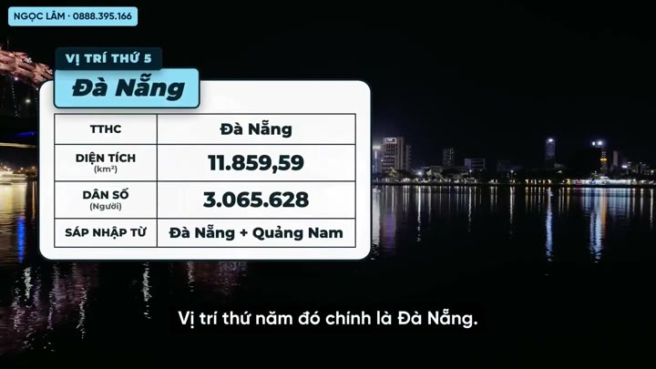

# Ghi chú video mẫu — "9 thành phố trực thuộc Trung ương, nơi nào phát triển nhanh nhất"

## 1. Thông tin
- Tiêu đề gốc: 9 thành phố trực thuộc Trung ương, nơi nào phát triển nhanh nhất
- Nền tảng: Facebook (video trang Ngọc Lâm BĐS), ngang 16:9
- Ngày đăng: 23/10/2026
- Thời lượng: 7:40 (459,8 giây)
- Lượt xem: 60.917 (cao nhất trong nhóm Facebook ngoài video chuyển về sống)
- Link: https://www.facebook.com/watch/?v=1901561431006553

## 2. Một câu
Xếp 9 thành phố trực thuộc Trung ương theo tốc độ tăng trưởng 6 tháng đầu năm (Hải Phòng thứ nhất, Quảng Ninh thứ hai, Bắc Ninh thứ ba), mỗi nơi mạnh ở ngành nào.

## 3. Format
**Xếp hạng / top N** (9 hạng, đếm ngược từ 9; mỗi hạng có tăng trưởng, thế mạnh, vài số riêng; kết bằng nhóm "ba thành phố miền Bắc phát triển bằng nhà máy và cảng").

## 4. Mở đầu (hook)
> "Trong 9 thành phố trực thuộc Trung ương của Việt Nam, nơi nào đang phát triển nhanh nhất? Bởi nửa đầu năm nay, khoảng cách giữa 9 cái tên đó dãn ra rất rõ. Từ thành phố có cảng biển và nhà máy lớn nhất miền Bắc, đến thành phố kiếm tiền từ di sản và cả 2 cái tên vừa lên thành phố trong tháng 9 này."

Công thức hook: **câu hỏi xếp hạng + "khoảng cách dãn ra rất rõ" (gợi người xem tự đoán) + mô tả khác nhau của các thành phố (không nói tên) + câu hỏi chốt "Hải Phòng xếp thứ bao nhiêu"**. Không tiết lộ đáp án, giữ người xem tới cuối.

## 5. Cấu trúc (theo SRT)
- 00:00 Hook
- 00:23 Chào + nói video làm gì
- 00:43 Tổng quan: 9 thành phố, Quảng Ninh lên thành phố đầu tháng 9, Bắc Ninh 20/9; nguồn tốc độ là "số ước tính 6 tháng đầu năm của Cục Thống kê"
- 01:13 Thứ 9: Cần Thơ (6,7%)
- 01:51 Thứ 8: Hà Nội (8,2%)
- 02:19 Thứ 7: Huế (8,33%)
- 02:52 Thứ 6: TP Hồ Chí Minh (8,55%)
- 03:25 Thứ 5: Đà Nẵng (9,52%)
- 03:57 Thứ 4: Đồng Nai (9,81%)
- 04:38 Thứ 3: Bắc Ninh (10,56%)
- 05:09 Thứ 2: Quảng Ninh (11,11%)
- 05:47 Thứ 1: Hải Phòng (11,33%), kèm mức Chính phủ giao 13% cho 5 năm tới
- 06:50 "Và có thể thấy…" 3 thành phố nhanh nhất đều ở miền Bắc
- 07:10 Tuy nhiên, mức giao cả năm cao hơn, nửa cuối năm phải nhanh hơn
- 07:20 Câu hỏi bình luận + like/đăng ký. 07:39 Whisper nghe thêm câu "Hãy subscribe cho kênh lalaschool…" ở đuôi: là phần lạc từ nhạc/đuôi, bỏ qua.

## 6. Hình ảnh
Contact sheet 12 khung đã xem. Phong cách:
- **Flycam thật và ảnh tư liệu từng thành phố**, không nền navy.
- **Thẻ xếp hạng nổi** ("VỊ TRÍ THỨ 6 · TP. HỒ CHÍ MINH" kèm bảng diện tích, dân số, nhập từ nơi nào) kiểu bảng thông tin nền trắng bo góc.
- Thẻ chữ nhấn dải xanh ở giữa trên hình ("QUY MÔ 6 THÁNG 359.707 TỶ — NHÓM 4 ĐỊA PHƯƠNG LỚN NHẤT").
- Thanh nhãn nhỏ góc trên trái "NGỌC LÂM 0888.395.166" (nền xanh nhạt), phụ đề trắng dưới giữa.
- Ba khung đã lưu: `anh-01.jpg`, `anh-02.jpg`, `anh-03.jpg`.

  

## 7. Cách đặt tiêu đề & mô tả
**Tiêu đề:** "9 thành phố trực thuộc Trung ương, nơi nào phát triển nhanh nhất". Công thức: *số + nhóm xếp hạng + câu hỏi "nơi nào … nhất"*.

**Mô tả Facebook:**
1. Câu hỏi đầu (có thêm "và Hải Phòng xếp thứ mấy").
2. Đoạn nói khoảng cách "giãn ra", hai thành phố mới (Quảng Ninh đầu tháng 9, Bắc Ninh ngày 20), và **thành phố đứng đầu cũng là nơi Chính phủ giao mức tăng trưởng cao nhất**.
3. Câu "Trong video em điểm từng nơi và thế mạnh của mỗi thành phố".
4. Hashtag (#haiphong #9thanhpho #tangtruongkinhte #quangninh #ngoclambds). Có nhắc **#quangninh**.

## 8. Lời kêu gọi (CTA)
> "Còn theo anh chị, trong 9 thành phố này, anh chị sẽ chọn nơi nào để về sinh sống và làm ăn? Hãy để lại ý kiến ở phần bình luận nhé!"

Câu hỏi này gợi người xem nghĩ tới chuyện "chuyển về ở", gần với việc mua nhà.

## 9. Số liệu & nguồn
- Tăng trưởng 6 tháng đầu năm: Cần Thơ 6,7%; Hà Nội 8,2%; Huế 8,33%; TP HCM 8,55%; Đà Nẵng 9,52%; Đồng Nai 9,81%; Bắc Ninh 10,56%; Quảng Ninh 11,11%; Hải Phòng 11,33%.
- Số riêng từng nơi: ví dụ Hà Nội 18 triệu lượt khách, thu ngân sách 411.000 tỷ; TP HCM quy mô 1,55 triệu tỷ; Bắc Ninh xuất khẩu 52,5 tỷ USD; Quảng Ninh thu ngân sách 6 tháng 48.556 tỷ (66% dự toán), khách 12,4 triệu lượt, du lịch vượt 35.000 tỷ, dịch vụ tăng 14,27%; Hải Phòng thu ngân sách hơn 113.000 tỷ, hàng qua cảng hơn 96 triệu tấn, vốn nước ngoài hơn 3,1 tỷ USD (hết tháng 8 hơn 3,47 tỷ).
- Chính phủ giao Hải Phòng tăng trưởng 13% cho 5 năm tới, Hà Nội 11%, TP HCM hơn 10%.
- **Nguồn:** nêu **"Cục Thống kê"** cho tốc độ tăng trưởng (lời nói, giây thứ 61). Các số khác không nêu nguồn.
- (Whisper chép "trực tượng trung ương" = trực thuộc Trung ương; "năm tới" trong hook nên hiểu "5 năm tới" theo đoạn sau.)

## 10. Làm cho Hạ Long Xanh / Quảng Ninh
**Gợi ý tiêu đề:**
1. "Quảng Ninh đứng thứ mấy trong 9 thành phố trực thuộc Trung ương? Vì sao? [cần tra: thứ hạng cập nhật]"
2. "Quảng Ninh tăng trưởng nhanh thứ [x]: than, cảng, du lịch, và cái gì nữa?"
3. "Hạ Long so với các thành phố biển lớn: ai tăng nhanh hơn? [cần tra: số liệu cùng kỳ]"

**Ghi chú:** video mẫu xếp Quảng Ninh thứ 2 (11,11% nửa đầu năm, theo lời Ngọc Lâm trích Cục Thống kê). Chị Linh **không dùng số này khi chưa tra lại** nguồn gốc ở Cục Thống kê.

**Chị Linh phải làm thật:**
- Tự lập bảng xếp hạng từ **một nguồn thống kê chính thức** (ghi tên, kỳ, ngày), không ghép từ báo khác nhau.
- Với Quảng Ninh: tăng trưởng, thu ngân sách, du lịch, vốn nước ngoài, mỗi số có nguồn [cần tra].
- Thêm góc "thành phố biển, du lịch" vì chị bán sản phẩm cao cấp ven biển.
- Flycam Hạ Long, Tuần Châu, vịnh; hình thật.

**Phải kiểm:** trạng thái hành chính của Quảng Ninh (video mẫu nói lên thành phố trực thuộc Trung ương đầu tháng 9/2026) [cần tra: văn bản chính thức và ngày]; mọi thứ hạng, mọi % so cùng kỳ.

**Lưu ý trung thực:** xếp hạng về "tăng trưởng" không phải xếp hạng "đáng mua nhà". Đừng để người xem hiểu nhầm là lời hứa giá nhà tăng.
