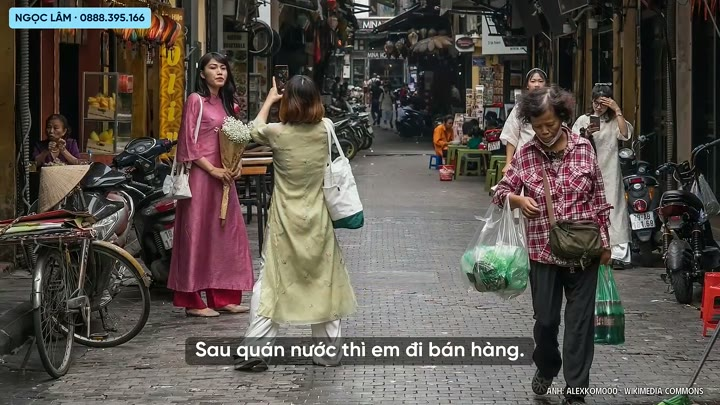
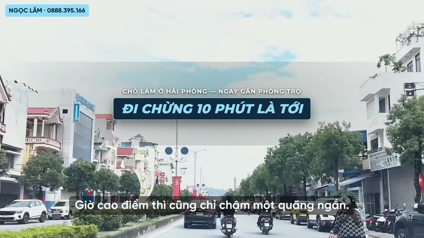
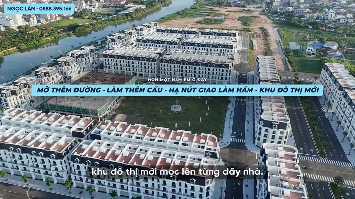

# Ghi chú video mẫu — "Rời Hà Nội sau 7 năm, em chọn Hải Phòng để ở lại" (bản Facebook)

> Đây là bản Facebook của video YouTube `20261014-D4InJTv33kg`. Ghi chú đầy đủ ở: [`../20261014-D4InJTv33kg/ghi-chu.md`](../20261014-D4InJTv33kg/ghi-chu.md). Dưới đây chỉ ghi chỗ khác.

## 1. Thông tin
- Tiêu đề gốc: Rời Hà Nội sau 7 năm, em chọn Hải Phòng để ở lại
- Nền tảng: Facebook (Reel/video trang Ngọc Lâm BĐS)
- Ngày đăng: 06/11/2026
- Thời lượng: 10:09 (608,9 giây)
- Lượt xem: 74.377 (nhiều gấp khoảng 9 lần bản YouTube, 8.421)
- Link: https://www.facebook.com/watch/?v=2217392492206954

## 2. Một câu
Giống bản YouTube: chuyện thật rời Hà Nội về Hải Phòng sống hơn một năm.

## 3. Format
**Kể chuyện chuyển về sống.** Cùng nội dung, hình và lời với bản YouTube (đã so contact sheet: giống nhau).

## 4. Mở đầu (hook)
> "Một người rời Hà Nội về Hải Phòng sống thì cuộc sống hơn Hà Nội chỗ nào? Bởi vì đó là chuyện của em hơn một năm vừa qua."

Cùng công thức hook như bản YouTube.

## 5. Cấu trúc
Giống bản YouTube. Facebook không có chapter, nên không có mốc giờ trong mô tả. Xem mục 5 của ghi chú YouTube.

## 6. Hình ảnh
Giống bản YouTube. Ba khung đã lưu: `anh-01.jpg`, `anh-02.jpg`, `anh-03.jpg`.

  

## 7. Cách đặt tiêu đề & mô tả (khác bản YouTube)
- **Tiêu đề Facebook** ngắn, kể từ ngôi "em", nghe như lời tâm sự: "Rời Hà Nội sau 7 năm, em chọn Hải Phòng để ở lại". Tiêu đề YouTube thì hứa kết quả ("được nhiều hơn mình tưởng"). Cùng một video, hai cách đặt tên cho hai nơi.
- **Mô tả Facebook** ngắn, chỉ 3 đoạn: (1) câu hỏi nêu lại, (2) chuyện của em với 2 con số (7 năm, 4 nghề, 3 triệu/tháng), (3) "có mấy chuyện thú vị hơn hẳn mà lúc khăn gói em không tính tới". Rồi 5 hashtag (#haiphong #roihanoi #chonhaiphong #chuyennghe #ngoclambds). Không có chapter, không có link, không có số điện thoại.

## 8. Lời kêu gọi (CTA)
Như bản YouTube (xin chỉ chỗ ăn ngon, bình luận, like, đăng ký). Mô tả Facebook không có CTA liên hệ.

## 9. Số liệu & nguồn
Như bản YouTube. Mô tả Facebook không ghi dòng nguồn "Cục Thống kê".

## 10. Làm cho Hạ Long Xanh / Quảng Ninh
Xem mục 10 của bản YouTube. Thêm một ý riêng về nền tảng: bản Facebook nên viết **tiêu đề tâm sự ngắn** (ngôi thứ nhất của người kể thật) và mô tả ngắn; bản YouTube thì thêm chapter + dòng "Nói cho công bằng". Chị Linh chỉ làm một video nhưng đặt hai bộ tiêu đề/mô tả.
