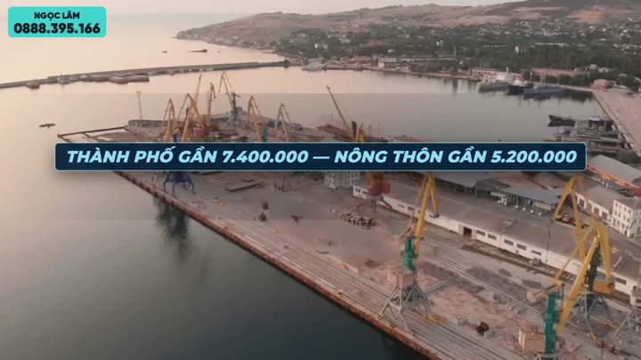

# Ghi chú video mẫu — "Top 6 tỉnh thành giàu nhất Việt Nam"

## 1. Thông tin
- Tiêu đề gốc: Top 6 tỉnh thành giàu nhất Việt Nam
- Nền tảng: Facebook (video trang Ngọc Lâm BĐS), ngang 16:9
- Ngày đăng: 03/11/2026
- Thời lượng: 6:58 (418,1 giây)
- Lượt xem: 24.248
- Link: https://www.facebook.com/watch/?v=3320117954863304

## 2. Một câu
Xếp 6 tỉnh thành có thu nhập bình quân đầu người cao nhất trong 34 tỉnh thành (Hà Nội đứng đầu, Hải Phòng thứ 4), mỗi nơi sống bằng nghề gì.

## 3. Format
**Xếp hạng / top N** (đếm ngược từ thứ 6; mỗi hạng: thu nhập, dân số, "sống bằng gì", một chi tiết lịch sử).

## 4. Mở đầu (hook)
> "Trong 34 tỉnh thành của Việt Nam, 6 nơi nào giàu nhất. Hải Phòng là thành phố cảng lớn nhất miền Bắc, kinh tế đứng thứ 3 cả nước. Nhưng trong 6 cái tên này, Hải Phòng chỉ đứng thứ 4."

(Whisper chép "kinh thầy" = kinh tế.)

Công thức hook: **câu hỏi xếp hạng + "nhân vật nhà" (Hải Phòng) + nghịch lý (kinh tế thứ 3 mà chỉ đứng thứ 4) + gợi 3 nơi lạ + "nơi đứng đầu lần trước nay không còn trên bản đồ"** (do sáp nhập tỉnh).

## 5. Cấu trúc (theo SRT)
- 00:00 Hook
- 00:22 Chào + nói video làm gì
- 00:40 Bối cảnh: thu nhập bình quân cả nước 2025 hơn 6 triệu/tháng, cao hơn 2024 là 10,9%; thành thị gần 7,4 triệu, nông thôn gần 5,2 triệu
- 01:16 Thứ 6: Ninh Bình (6,572 triệu; nhập từ Hà Nam, Nam Định, Ninh Bình; Tràng An)
- 02:18 Thứ 5: Quảng Ninh (6,917 triệu; than, Vịnh Hạ Long, cửa khẩu; Yên Tử)
- 03:06 Thứ 4: Hải Phòng (7,139 triệu; nhập thêm Hải Dương)
- 03:47 Thứ 3: Đồng Nai (7,174 triệu; hơn 40 khu công nghiệp; điều)
- 04:36 Thứ 2: TP Hồ Chí Minh (8,064 triệu; nhập Bình Dương, Bà Rịa – Vũng Tàu)
- 05:22 Thứ 1: Hà Nội (8,374 triệu)
- 06:09 "Và có thể thấy…" 4 trong 6 nơi giàu nhất ở miền Bắc; khoảng cách giữa hạng 3 – 6 chỉ trong khoảng 600.000 đồng/tháng
- 06:40 Câu hỏi bình luận + like/đăng ký + cảm ơn

## 6. Hình ảnh
Contact sheet 12 khung đã xem. Phong cách:
- Flycam thật và ảnh tư liệu từng tỉnh (cảng, đền, cầu, khu công nghiệp, vườn điều, sông Sài Gòn…).
- **Thẻ xếp hạng nền trắng bo góc** ("VỊ TRÍ THỨ 6 · Ninh Bình": thu nhập, dân số, nhập từ nơi nào), ghi rõ hạng.
- Dải chữ nhấn xanh dưới giữa ("TRÀNG AN — DI SẢN THẾ GIỚI CẢ VĂN HOÁ LẪN THIÊN NHIÊN", "NHÀ MÁY · CẢNG · BUÔN BÁN", "HƠN 33 TRIỆU LƯỢT KHÁCH — THU VỀ HƠN 134.000 TỶ ĐỒNG").
- Thanh nhãn nhỏ góc trên trái "NGỌC LÂM 0888.395.166", phụ đề trắng dưới giữa.
- Ba khung đã lưu: `anh-01.jpg`, `anh-02.jpg`, `anh-03.jpg`.

  

## 7. Cách đặt tiêu đề & mô tả
**Tiêu đề:** "Top 6 tỉnh thành giàu nhất Việt Nam". Công thức: *Top + số + tiêu chí ("giàu nhất") + quốc gia*. Đúng thứ người ta hay tìm, dễ chia sẻ.

**Mô tả Facebook:**
1. Câu hỏi đầu gắn Hải Phòng: "6 nơi nào giàu nhất, Hải Phòng đứng ở đâu".
2. Đoạn nghịch lý: kinh tế thứ ba mà chỉ đứng thứ tư; mô tả 3 nơi lạ ("sống bằng than và vịnh Hạ Long", "dầu ngoài biển", "vải thiều + ô tô"); "nơi đứng đầu lần trước nay không còn trên bản đồ".
3. Số: thu nhập bình quân cả nước 2025 hơn 6 triệu, cao hơn 2024 là 10,9%.
4. Hashtag (#haiphong #tinhthanhgiaunhat #thunhapbinhquan #kinhtevietnam #ngoclambds).

## 8. Lời kêu gọi (CTA)
> "Còn theo anh chị, trong 6 cái tên này, anh chị thấy nơi nào dễ sống nhất? Hãy để lại ý kiến và bình luận nhé!"

## 9. Số liệu & nguồn
- Thu nhập bình quân cả nước 2025: hơn 6 triệu; tăng 10,9% so 2024; thành thị gần 7,4 triệu, nông thôn gần 5,2 triệu; Đông Nam Bộ cao nhất (gần 7,5 triệu); Trung du và miền núi phía Bắc thấp nhất (gần 4,2 triệu).
- Bảng thu nhập (đồng/tháng): Ninh Bình 6.572.000; Quảng Ninh 6.917.000; Hải Phòng 7.139.000; Đồng Nai 7.174.000; TP HCM 8.064.000; Hà Nội 8.374.000.
- Dân số: Hải Phòng 4,664 triệu; Đồng Nai 4,491 triệu; Quảng Ninh khoảng 1,5 triệu; Hà Nội hơn 8,8 triệu; TP HCM hơn 14 triệu.
- Số khác: Hà Nội đón hơn 33 triệu lượt khách, thu hơn 134.000 tỷ; Quảng Ninh đón hơn 21 triệu lượt, thu hơn 57.000 tỷ; Quảng Ninh kinh tế 9 tháng tăng 12,54%.
- **Nguồn:** trong lời nói và mô tả **không nêu tên cơ quan** (chỉ thấy "thu nhập bình quân năm 2025"). Chị Linh phải ghi nguồn rõ nếu làm lại.

## 10. Làm cho Hạ Long Xanh / Quảng Ninh
**Gợi ý tiêu đề:**
1. "Top 5 địa phương du lịch biển đáng sống nhất miền Bắc: Quảng Ninh đứng thứ mấy? [cần tra: tiêu chí và nguồn]"
2. "Thu nhập người Quảng Ninh đứng thứ mấy trong 34 tỉnh thành? [cần tra]"
3. "6 thành phố có biển của Việt Nam: nơi nào thu nhập và khách du lịch cao nhất?"

**Ghi chú:** video mẫu đặt Quảng Ninh thứ 5 (6.917.000 đồng/tháng, lời Ngọc Lâm). Chị Linh không dùng khi chưa tra lại nguồn gốc.

**Chị Linh phải làm thật:**
- Chọn **một tiêu chí rõ** và một nguồn chính thức (thu nhập bình quân, hay khách du lịch, hay thu ngân sách). Không gộp nhiều tiêu chí.
- Mỗi hạng 4 – 5 câu: số, "sống bằng gì", một chi tiết thật (như di sản, cảng).
- Hình thật: flycam Hạ Long, Tuần Châu, vịnh; ảnh tư liệu ghi nguồn.

**Phải kiểm:** mọi con số thu nhập, dân số, năm số liệu, tên đơn vị hành chính (nhiều tỉnh đã sáp nhập; video mẫu nhắc "nhập từ…") [cần tra: cơ quan thống kê, năm].

**Lưu ý:** dạng top là format **dễ chia sẻ nhất** (24 nghìn lượt xem video này, 61 nghìn video 9 thành phố), nhưng phải sạch nguồn. Tránh tiêu đề "giàu nhất" nếu tiêu chí là thu nhập bình quân (nên ghi "thu nhập bình quân cao nhất").
